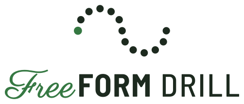
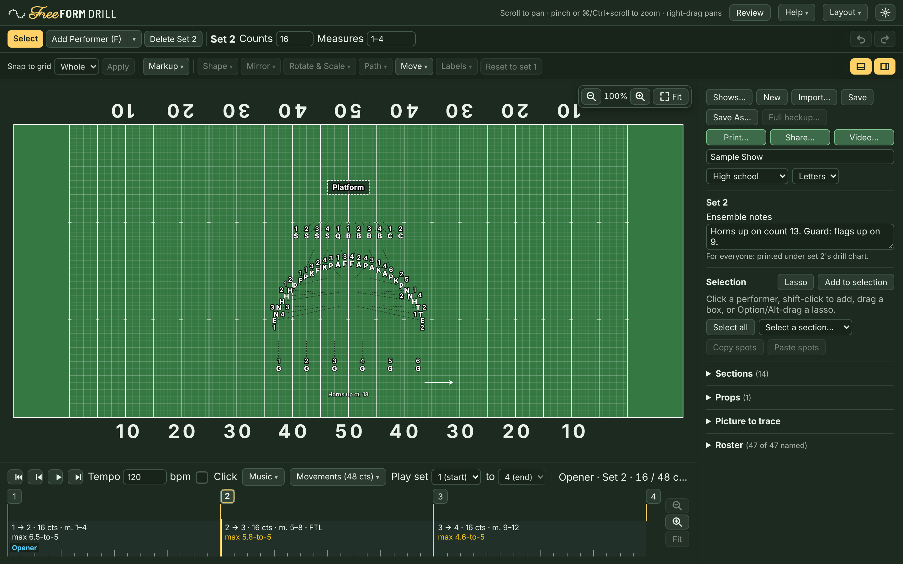

<h1 align="center">
  <picture>
    <source media="(prefers-color-scheme: dark)" srcset="brand/freeform-drill-logo-dark.svg">
    
  </picture>
</h1>

<p align="center"><em>Drill, without the bill.</em></p>

**FreeFORM is a free and open-source drill design and learning tool for all marching arts organizations.**

I'm a former band director. Over my career teaching in public and private K-12 schools, I wrote several marching band shows in Pyware, and over the years the software frustrated me more and more: the yearly license fee, the limits on how many performers a show could have, and the tools locked behind higher tiers. I built FreeFORM because I wanted a drill writing tool that was easy to use, gave users every tool from the start, worked for marching ensembles of any size, and eased my organization's financial burden. I made FreeFORM free and open-source because I believe other marching arts directors and drill writers may want a tool that solves these same pain points.

FreeFORM runs in your web browser, or as an app on your home screen. There's nothing to install. Your shows are saved in the browser on your device, and once you've opened FreeFORM, it works offline too. You can quickly add performers to a show, build sets, watch the moves between sets play out count by count, print drill charts and individual dot sheets, and send the show to your students' and staff members' devices.

FreeFORM is released under the [MIT license](LICENSE), so anyone is free to use it, share it, and change it as they need to, as long as the license notice stays with it.

Sharing a show is easy: students and staff scan a QR code (or open a link you text or email them) on their phones or tablets. Once the show is loaded, anyone can look up a performer's coordinates (their "dot") and watch any move from the director's point of view, facing the audience the way a performer would, or following their own dot. That helps students and staff learn the show quickly.

A note on where the ideas came from: FreeFORM is modeled on Pyware and the Ultimate Drill Book (UDB), but no proprietary code went into it (see [Clean room](#clean-room)).

**Use it here:** <https://freeformdrill.org/>

**New to FreeFORM? Start with the [How-to guide](https://freeformdrill.org/guide/)** (also in the app, under **Help**). It walks through everything below, step by step, with pictures.



> **Status:** early, and I'm working on it actively. Everything listed below works today. Shows are saved in your browser, in files you save, and in the links you share. There are no accounts and no cloud sync yet.

## What it does

**Writing drill**
- A football field with high school, college/DCI, or NFL hashes and an 8-to-5 grid, seen from the press box (Side 1 on the left), or a basketball court or custom floor for indoor shows.
- Coordinates in standard drill language, like "2 steps outside the Side 2 45, 2 steps in front of Front Hash."
- Sections with letters and colors, a roster of names (paste it from a spreadsheet), and labels that stay out of each other's way.
- Shapes: line, arc, curve, Bézier, circle, polygon, star, spiral, block, and letters (spell a word). A picture under the field to trace. FreeFORM assigns spots by least total travel, so paths don't cross.
- Rotate and stretch a group by dragging handles on the field, or turn it around one performer for a gate turn. Flip across the 50 or front to back, or copy one side to the other.
- Paths: straight, follow the leader (with turns or a smooth curve, and counter-marches), or a custom path for one performer.
- Delayed step-offs (hold 4, move 12) and turning moves, where a rotating group marches arcs instead of straight lines.
- Props (platforms, backdrops) that sit in a different spot each set and move between sets.
- Dim or hide sections while you write the others.
- Lasso selection (Option-drag, or the **Lasso** button on a touch screen). Select everyone or a whole section, copy spots from one set and paste them into another, and see how far apart two performers are.
- Step-size warnings (yellow past a 6-to-5, red past the show's step limit, a 4-to-5 unless you change it), with a red ring on everyone over the limit, and a warning when two performers come within a step of each other at any point in a move. Click a warning to jump to who it's about.
- **Review**: one list of the problems it checks for across the show (steps over the limit, performers too close, imported Pyware paths that went straight after an edit, missing spots, and counts not written yet). Click one to go there with its performers selected.
- Text, arrows, and freehand markup on each set, plus ensemble notes and per-performer notes.
- Undo for every edit.
- Sidebar on the left or right, and the timeline on the top or bottom (**Layout**, in the top bar).

**Timing and music**
- A timeline you can scrub count by count, play at any tempo (with a click if you like, on the computer or the phone), or loop over a range of sets.
- Lay out a show by counts first (one movement per tune), then add sets at any count.
- Sync to a recording: take every count's timing from the MuseScore score (or MusicXML or MIDI), or tap the counts along with any mp3.

**Getting it to the band**
- Dot sheets (four cards per page, one per page with a notes column, or one per page with a small field picture for each set, like a dot book) and drill charts (one per set, with or without the paths into it), printed or saved as PDF, for the whole show or a range of sets.
- A video of the show (MP4, the whole field, with the music and the set and count on screen) for the group chat, staff, or boosters.
- A Share dialog with two choices: **Send this version** (a link with a QR code; the whole show is in the link, with no server involved) or **Keep phones up to date**. Each says what's included (names, notes, music) before you get a link.
- **Publish to phones**: one click, no account. The show is encrypted in your browser, and the key is only in the link, so the copy online can't be read without it. The link updates itself on phones, can carry the music, and keeps names private. A new computer mid-season keeps the same link (Full backup, or a recovery code), and a lost show comes back from the link itself. (Or publish to your own GitHub repository, or host the file anywhere.) Each publish gets a revision number that shows on phones and printed sheets.
- A white field with black lines, letters, and labels for writers who prefer it (Layout → White field), or the usual green turf.
- The phone's performer view and the front page in Spanish (a first draft; the editor is next).
- A performer view for phones: pick who you are. Upright, the phone lists your dots set by set, like a dot sheet, with counts, step size in plain words ("normal step size (8-to-5), moving back and to your left"), and notes. On its side, it shows the field (following your dot, if you like) and playback. A switch flips between the two on a phone locked upright. A phone keeps several shows (the Opener, Ballad, and Closer as separate files) and switches between them from a menu. Students can loop a range of sets to practice, with a 4-count count-in if they like. A move that isn't a straight line says so, with a **Watch** button that plays just that move. It works offline once it's opened, and one line says whether it's ready offline, which revision it has, and whether that's the latest (with **Check for updates**). It says so plainly if the phone can't save it.
- A two-minute guide for students, in English and Spanish, at freeformdrill.org/students/ (written in [docs/STUDENTS.md](docs/STUDENTS.md)).

**Files**
- Autosave in your browser, plus **Save** (to any folder you choose, where the browser allows it) and import of `.freeform` files. FreeFORM says so if the browser can't autosave.
- Several shows in one browser (Opener, Ballad, Closer) under **Shows…**: open, rename, duplicate, or delete them, each with its own recording and tracing picture.
- Earlier versions of each show, kept as you work, to look back at and restore.
- A warning when the same show is changed in two tabs, instead of one quietly saving over the other.
- **Full backup…**: a show file that also holds the recording and tracing picture, to move a show to another computer complete.
- A sample show to look around in before you write your own, and a practice show: the same drill with three problems to find and fix in Review, each explained in its notes.
- Import Pyware 3D (`.3dj`) shows, tested with files from 2008 to 2010.

It runs on a current Chrome, Edge, Firefox, or Safari, and on iPadOS/iOS 16.4 or later. Write drill on a computer or an iPad (hide the timeline and sidebar for more field). Phones get only the performer view.

## Roadmap

The full list is in [PLAN.md](PLAN.md). What's next, roughly:

- A FreeFORM-run upload service, so keeping phones up to date doesn't need a GitHub account
- Touch versions of the few actions that still need a keyboard key
- Faster count entry for recordings that weren't made from the score (tap a few downbeats, FreeFORM fills in the rest)
- Markup that spans several sets
- Later: optional cloud sync and app-store versions

## Running it yourself

You need [Node.js](https://nodejs.org/) 22 or newer.

```sh
npm install
npm run dev        # the site, at the address it prints (the editor is at /app/)
npm test           # unit tests
npm run typecheck  # TypeScript checks
npm run build      # production build in dist/
```

Every push to `main` runs the checks and tests and then publishes to GitHub Pages ([`.github/workflows/deploy.yml`](.github/workflows/deploy.yml)). If a test fails, the site doesn't update.

### Screenshots

The pictures in the How-to guide and this README are made by a script, from a sample show in [`src/engine/sample.ts`](src/engine/sample.ts) (and, for the warnings, its practice show). After a change to anything they show, retake them:

```sh
npm i --no-save playwright && npx playwright install chromium   # once
node scripts/screenshots.mjs              # all of them
node scripts/screenshots.mjs ftl print    # or just these
```

### Code map

| Path | What's there |
|---|---|
| `src/engine/` | The drill logic, with no UI: coordinates and readouts, the show model, shapes, markup, undo, which versions to keep, music timing, share links and locked files, QR codes, the Pyware reader, and the whole-show Review. Unit-tested. |
| `src/field/` | Drawing the field, performers, shapes, and markup, plus dot-label placement and the rotate/stretch frame |
| `src/ui/` | The toolbar, sidebar, timeline, Review list, music menu, show list, color palette, the keyboard handling every dialog shares (`useDialog`), where the sidebar and timeline sit (`layout.ts`), and browser storage (`audioStore.ts`, `showStore.ts`: recordings, pictures, the show library, and versions in IndexedDB) |
| `src/print/` | Dot sheets and drill charts |
| `src/perform/` | The performer view, the Share dialog, and the QR scanner |
| `index.html`, `app/index.html` | The front page (freeformdrill.org) and the app (freeformdrill.org/app/), which old links (`/#show=…`) are forwarded to |
| `src/guide/` | Turns `docs/HOW-TO.md` into the guide page on the site (`/guide/`) when the site is built |
| `services/api/` | FreeFORM's small web service on Cloudflare (api.freeformdrill.org): the feedback form (emailed to Jason) and published shows (encrypted files only, in Workers KV, cleaned up after a year unused). Deploy steps in its README |
| `public/` | App icons, logos, the link-preview image, the manifest, and the offline service worker (it keeps what the build lists in `precache.json`) |
| `docs/` | The How-to guide and its screenshots (the only copy: the site's guide page is made from it) |
| `scripts/` | The screenshot script |
| `brand/` | Logo files, colors, and rules ([brand/README.md](brand/README.md)) |

Positions are stored in 8-to-5 steps (one step is 22.5 inches), measured from where the 50 meets the front sideline. +x points toward Side 2 and +y toward the back sideline. Every readout is worked out from that.

## How decisions get made

Every design decision is logged in [DECISIONS.md](DECISIONS.md): when, who made it, what else was considered, and why. If you wonder why something works the way it does, look there first. [IDEA.md](IDEA.md) is the original brief.

### Clean room

FreeFORM is written from scratch. I studied Pyware and UDB only through how they behave and what their documentation says, never by decompiling them, and there's no third-party code or show file in this repo.

## Supporting FreeFORM

FreeFORM is free and always will be. If it saves your program money, you can [buy me a coffee on Ko-fi](https://ko-fi.com/tillerdawg) to help with hosting. It's never required.

## Contributing

Issues and pull requests are welcome (see [CONTRIBUTING.md](CONTRIBUTING.md)), especially from drill writers and band directors who can say how things *should* work. If you change or add a feature, please update this README, the [How-to guide](docs/HOW-TO.md) (and its screenshots, if they show it) and [DECISIONS.md](DECISIONS.md) in the same change. [CLAUDE.md](CLAUDE.md) has the house rules.

## License

[MIT](LICENSE) © Jason Tiller and FreeFORM contributors.
