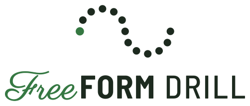

# FreeFORM logo and brand

<p align="center">
  <picture>
    <source media="(prefers-color-scheme: dark)" srcset="freeform-drill-logo-dark.svg">
    
  </picture>
</p>

**Tagline:** *Drill, without the bill.*

The mark is the **FreeFORM curve**: 13 dots in an S, evenly spaced (the same idea as FreeFORM's even-steps rule), with the first dot as the accent, like Set 1. The wordmark sets **Free** in a flowing script against **FORM** in sturdy block capitals: the free-form side and the formation side of drill.

The full name is **FreeFORM Drill**. The main logo sets FreeFORM DRILL on one line (DRILL in Barlow Medium, so FreeFORM still leads) with the curve centered over it. Inside the app, where space is tight, the toolbar keeps the shorter FreeFORM logo and the curve.

## Files

The logo, small logo, FF monogram, and curve each come in a **dark** version (for dark backgrounds) and a **light** version (for white paper and light backgrounds). The app icons and favicon come in one version each. Letters are converted to outlines, so no fonts are needed to use them.

| File | Use it for |
|---|---|
| `freeform-drill-logo-{dark,light}.svg` | **The main logo:** FreeFORM DRILL with the curve over it. README, website, phone start screen, link previews, dot-book covers: anywhere there's room above the name. |
| `freeform-drill-stacked-{dark,light}.svg` | Square avatar: the curve, FreeFORM, and DRILL on a rounded tile. App store listings, GitHub and social avatars, title slides. Under about 64 px, use the app icon instead. |
| `freeform-drill-badge-{dark,light}.svg` | Round badge for merch: "Drill, without the bill." over the top and freeformdrill.org along the bottom, on a filled disc. Shirts, stickers, dot-book covers. Needs about 250 px or more. |
| `freeform-logo-{dark,light}.svg` | FreeFORM without DRILL, one line. Wide headers where the full name is already nearby. |
| `freeform-logo-small-{dark,light}.svg` | Toolbar-size headers. "Free" is 20% bigger and its strokes heavier, so the script survives small sizes. |
| `freeform-ff-{dark,light}.svg` | FF monogram: square spots, avatars, merch. The gap where the letters cross is see-through. |
| `freeform-ff-icon.svg` | FF on a rounded green tile: stickers, avatars, anywhere a square badge fits. |
| `freeform-mark-{dark,light}.svg` | The curve alone: favicons and anything 16 px or so, where the script would turn to a scribble. |
| `freeform-app-icon.svg` | **The app icon** (Android/manifest source): the curve with fat dots on field dark, full-bleed (phones round or circle it), small enough to survive Android's tightest circle crop. |
| `freeform-app-icon-ios.svg` | The same for iPhone/iPad, with a bigger curve: Apple never crops to a circle. |
| `freeform-app-icon-ff.svg` | Alternate app icon: FF on field dark. Not used by the app yet. |
| `freeform-favicon.svg` | Source of the browser-tab icon: the curve with fatter dots, dark on light tabs and light on dark tabs. |

**In the app** (`public/`): `favicon.svg` (copied from `freeform-favicon.svg`), `favicon-32.png` for browsers without SVG favicons, `apple-touch-icon.png` (from `freeform-app-icon-ios.svg`), and `icon-192.png` and `icon-512.png` (both from `freeform-app-icon.svg`). Also `logo.svg` (the FreeFORM Drill logo: phone start screen, old-browser page), `logo-small.svg` and `mark.svg` (the editor's top bar: the small logo, or just the curve in narrow windows), each with a `-light` version for light mode, and `og-image.png` (the FreeFORM Drill logo), the 1200 × 630 card shown when a FreeFORM link is pasted into a message (its address in `index.html` is freeformdrill.org).

<p>
  
  &nbsp;
  
  &nbsp;
  <picture>
    <source media="(prefers-color-scheme: dark)" srcset="freeform-ff-dark.svg">
    
  </picture>
  &nbsp;
  <picture>
    <source media="(prefers-color-scheme: dark)" srcset="freeform-mark-dark.svg">
    
  </picture>
</p>

## Rules

- Full logo at header size and up; small logo at toolbar size.
- Below toolbar size, use the curve alone, never the wordmark. The curve is also the app icon and the favicon.
- FF is for square brand spots (avatars, shirts, stickers), not the app icon: its script F thins out at icon sizes.
- Dark files on dark grounds, light files on white.
- Keep the curve's 13 dots evenly spaced, with the first dot as the accent.
- Don't redraw the logo in live text; use these files.

## Colors

From the app's palette (`src/ui/palette.ts`):

| Color | Hex | In the logo |
|---|---|---|
| Gold | `#ffd166` | "Free" and the first dot, on dark |
| Off-white | `#e9f0ea` | "FORM" and the dots, on dark |
| Turf | `#357842` | "Free" and the first dot on white; the FF badge tile |
| Field | `#1d2a1f` | "FORM" and the dots on white; dark backgrounds |

## Type

Used in the logo only; the app itself uses the system font.

- **Free:** [Parisienne](https://fonts.google.com/specimen/Parisienne), with a thin outline added to strengthen its hairlines.
- **FORM:** [Barlow Semi Condensed](https://fonts.google.com/specimen/Barlow+Semi+Condensed) Bold, all caps.

Both are under the SIL Open Font License. Because the logo files are outlines, the fonts themselves aren't shipped.

## Rebuilding

`build_logo.py` regenerates the FreeFORM files, and `build_drill_logo.py` the FreeFORM Drill ones, from the two fonts:

```sh
npm i --no-save @fontsource/parisienne @fontsource/barlow-semi-condensed
pip install fonttools brotli uharfbuzz
python3 brand/build_logo.py node_modules/@fontsource brand
python3 brand/build_drill_logo.py node_modules/@fontsource brand
```

Then, to refresh the app's icons in `public/` (needs Playwright's Chromium):

```sh
npm i --no-save playwright && npx playwright install chromium
node brand/render_icons.cjs
```

After changing any icon, bump `CACHE` in `public/sw.js`: the offline helper keeps files without a hash in their name forever, so phones would otherwise keep the old icon.

Why the logo looks the way it does, and what else was considered, is in [DECISIONS.md](../DECISIONS.md) (2026-11-03).
