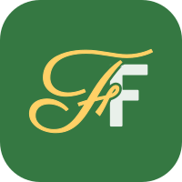
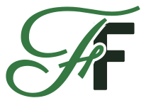

# Freeform logo and brand

<p align="center">
  <picture>
    <source media="(prefers-color-scheme: dark)" srcset="freeform-logo-dark.svg">
    
  </picture>
</p>

**Tagline:** *Drill, without the bill.*

The mark is the **Freeform curve**: 13 dots in an S, evenly spaced (the same idea as Freeform's even-steps rule), with the first dot as the accent, like Set 1. The wordmark sets **Free** in a flowing script against **FORM** in sturdy block capitals: the free-form side and the formation side of drill.

## Files

Every file comes in a **dark** version (for dark backgrounds) and a **light** version (for white paper and light backgrounds). Letters are converted to outlines, so no fonts are needed to use them.

| File | Use it for |
|---|---|
| `freeform-logo-{dark,light}.svg` | Full logo. README, website, dot-book covers, headers: anything header size and up. |
| `freeform-logo-small-{dark,light}.svg` | Toolbar-size headers. "Free" is 20% bigger and its strokes heavier, so the script survives small sizes. |
| `freeform-ff-{dark,light}.svg` | FF monogram: square spots, avatars, merch. The gap where the letters cross is see-through. |
| `freeform-ff-icon.svg` | App icon: the FF monogram on a rounded green tile. |
| `freeform-mark-{dark,light}.svg` | The curve alone: favicons and anything 16 px or so, where the script would turn to a scribble. |
| `freeform-app-icon.svg` | Source of the app's home-screen icons: FF on a full-bleed green square (phones round or circle it), small enough to survive Android's tightest circle crop. |
| `freeform-favicon.svg` | Source of the browser-tab icon: the curve with fatter dots, dark on light tabs and light on dark tabs. |

**In the app** (`public/`): `favicon.svg` (copied from `freeform-favicon.svg`), `favicon-32.png` for browsers without SVG favicons, and `apple-touch-icon.png`, `icon-192.png` and `icon-512.png` (rendered from `freeform-app-icon.svg`).

<p>
  
  &nbsp;
  <picture>
    <source media="(prefers-color-scheme: dark)" srcset="freeform-ff-dark.svg">
    
  </picture>
  &nbsp;
  <picture>
    <source media="(prefers-color-scheme: dark)" srcset="freeform-mark-dark.svg">
    
  </picture>
</p>

## Rules

- Full logo at header size and up; small logo at toolbar size.
- Below toolbar size, use the curve alone, never the wordmark.
- Dark files on dark grounds, light files on white.
- Keep the curve's 13 dots evenly spaced, with the first dot as the accent.
- Don't redraw the logo in live text; use these files.

## Colors

From the app's palette (`src/ui/palette.ts`):

| Color | Hex | In the logo |
|---|---|---|
| Gold | `#ffd166` | "Free" and the first dot, on dark |
| Off-white | `#e9f0ea` | "FORM" and the dots, on dark |
| Turf | `#357842` | "Free" and the first dot on white; the app-icon tile |
| Field | `#1d2a1f` | "FORM" and the dots on white; dark backgrounds |

## Type

Used in the logo only; the app itself uses the system font.

- **Free:** [Parisienne](https://fonts.google.com/specimen/Parisienne), with a thin outline added to strengthen its hairlines.
- **FORM:** [Barlow Semi Condensed](https://fonts.google.com/specimen/Barlow+Semi+Condensed) Bold, all caps.

Both are under the SIL Open Font License. Because the logo files are outlines, the fonts themselves aren't shipped.

## Rebuilding

`build_logo.py` regenerates every file from the two fonts:

```sh
npm i --no-save @fontsource/parisienne @fontsource/barlow-semi-condensed
pip install fonttools brotli uharfbuzz
python3 brand/build_logo.py node_modules/@fontsource brand
```

Then, to refresh the app's icons in `public/` (needs Playwright's Chromium):

```sh
npm i --no-save playwright && npx playwright install chromium
node brand/render_icons.cjs
```

After changing any icon, bump `CACHE` in `public/sw.js`: the offline helper keeps files without a hash in their name forever, so phones would otherwise keep the old icon.

Why the logo looks the way it does, and what else was considered, is in [DECISIONS.md](../DECISIONS.md) (2026-11-03).
