# How to use FreeFORM

This guide walks you through writing a show in FreeFORM, from an empty field to dot sheets in your students' hands and the drill on their phones. It's written for band directors and drill writers. You don't need to have used Pyware or UDB before, but if you have, most of this will feel familiar.

FreeFORM runs in your web browser at <https://freeformdrill.org/>. There's nothing to install and no account to make.

The pictures in this guide come from a small sample show (47 performers, 4 sets) that ships with the code. Your screen will look the same, just with your own drill on it.

## Contents

1. [Before you start](#before-you-start)
2. [A quick tour of the editor](#a-quick-tour-of-the-editor)
3. [Set up a new show](#set-up-a-new-show)
4. [Add performers](#add-performers)
5. [Select and move performers](#select-and-move-performers)
6. [Sets, counts, and the timeline](#sets-counts-and-the-timeline)
7. [Shapes: lines, arcs, curves, circles, polygons, stars, spirals, blocks, and letters](#shapes-lines-arcs-curves-circles-polygons-stars-spirals-blocks-and-letters)
8. [Rotate, stretch, and flip](#rotate-stretch-and-flip)
9. [Follow-the-leader](#follow-the-leader)
10. [Step-offs and turning moves](#step-offs-and-turning-moves)
11. [Facing and equipment](#facing-and-equipment)
12. [Props](#props)
13. [Step-size and too-close warnings](#step-size-and-too-close-warnings)
14. [Dot labels](#dot-labels)
15. [Markup and notes](#markup-and-notes)
16. [Play it back](#play-it-back)
17. [Add your music](#add-your-music)
18. [Print dot sheets and drill charts](#print-dot-sheets-and-drill-charts)
19. [Send the show to your performers](#send-the-show-to-your-performers)
20. [What performers see on their phones](#what-performers-see-on-their-phones)
21. [Using an iPad](#using-an-ipad)
22. [Saving, backing up, and opening files](#saving-backing-up-and-opening-files)
23. [Keyboard shortcuts](#keyboard-shortcuts)
24. [If something goes wrong](#if-something-goes-wrong)

## Before you start

You'll want a computer or an iPad to write drill. FreeFORM needs a current version of Chrome, Edge, Firefox, or Safari, or iPadOS 16.4 or later (any iPad from 2017 on). If your browser is too old, you'll get a page that says so.

Phones only get the performer view. That's on purpose: a phone screen is too small to write drill on, but it's perfect for a student checking their spot.

One thing to know up front: **your show is saved in the browser you're using.** FreeFORM saves every change automatically, but only on that computer, in that browser. If you clear your browser data, or switch from Chrome to Safari, your show won't be there. Use **Export** often to keep a copy you control (see [Saving, backing up, and opening files](#saving-backing-up-and-opening-files)).

## A quick tour of the editor

From top to bottom:

- **The top bar** shows the set you're on, with its counts and measures, **+ Add set**, and **Delete set**. The sun/moon button at the far right switches between dark mode (the default) and light mode. The field looks the same either way.
- **The drill toolbar** has two rows. The first row picks what a click on the field does: **Select Performer(s)** or **Add Performer(s)**. It also has **Delete Performer(s)**, and at the right end Undo, Redo, Fit (zooms back out to the whole field), the timeline button, and the sidebar button. The second row has the tools for placing and moving performers: **Snap to grid**, **Markup**, **Shape**, **Transform**, **FTL**, **Labels**, and **Reset to set**.
- **The field** is in the middle. You're looking at it from the press box: the front sideline is at the bottom and Side 1 is on the left. Scroll to move around, and pinch (or hold ⌘ or Ctrl and scroll) to zoom.
- **The timeline** runs across the bottom. Each set has a numbered button, and each move between sets shows its counts, measures, and biggest step size.
- **The sidebar** on the right holds the show's file buttons, title, and hash marks; the current set's notes; whatever you have selected; and the **Sections** and **Roster** lists. The sidebar button (at the right end of the toolbar) shows and hides it.

## Set up a new show

Click **New** in the sidebar to start a show. (If you already have one open, FreeFORM asks first, and Undo brings it back.)

1. **Name it.** Type the title in the box under the file buttons. It prints on every dot sheet and chart.
2. **Pick your field.** The menu under the title has **High school**, **College / DCI**, and **NFL** for a football field, plus **Basketball court** and **Custom floor** for indoor shows (more on those just below). For a football field FreeFORM draws the field the way drill software does, with whole-step hashes:

   | Level | Sideline to hash / hash to hash / hash to sideline |
   |---|---|
   | High school | 28 / 28 / 28 steps |
   | College / DCI | 32 / 20 / 32 steps |
   | NFL | 36 / 12 / 36 steps |

   If you change the hashes after you've written drill, FreeFORM asks whether performers should keep their places relative to the hashes (on the hash stays on the hash) or keep their exact spots on the field.

   **Indoor shows.** **Basketball court** draws a 94 by 50 foot court with its lines. **Custom floor** is a plain floor or tarp: type how **Wide** and **Deep** it is in feet. Indoors, coordinates read from the center line and the nearer front or back edge, like "3 steps Side 1 of center, 2.5 steps behind Front Sideline" on a court or "… behind Front Edge" on a floor. The step grid works the same as outside. If you switch a show you've already written onto a floor, performers keep their spots in steps, and FreeFORM tells you if any end up off the floor. **Place exactly** is for football fields only for now.

   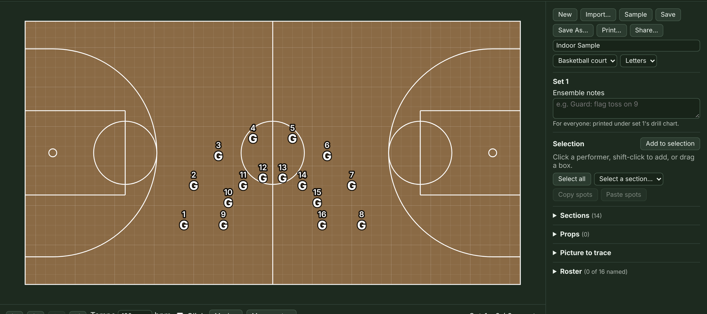
3. **Letters or dots.** By default each performer is drawn as their section letter with their number beside it (a P with a 4). Switch the menu beside the field to **Dots** if you'd rather see plain dots labeled P4.
4. **Check your sections.** Open **Sections** in the sidebar.

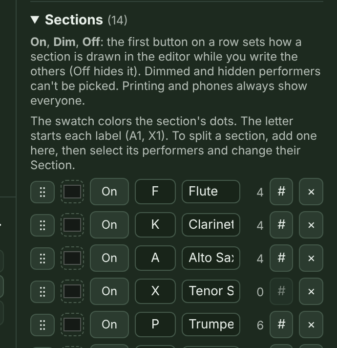

New shows start with Flute (F), Clarinet (K), Alto Sax (A), Tenor Sax (X), Trumpet (P), Mellophone (H), Trombone (N), Baritone (E), Tuba (T), Snare (S), Quads (Q), Bass Drum (B), Cymbals (C), and Color Guard (G). There's no front ensemble, since they usually stay put, but you can add one.

In the Sections list you can:

- Rename a section or change its letter. If two sections share a letter, FreeFORM flags them, since their labels would look the same.
- Give a section a color with the swatch. Its dots show in that color on the field, on phones, and on printed charts. **Clear colors** goes back to plain dots.
- Add or delete a section. If you delete one that has performers, you pick where they go.
- Reorder the list by dragging the dotted grip at the left of a row, or use **Sort** for score order, by letter, or by name. Dot sheets print in this order.
- Renumber a section with **#**: **Close the gaps** (X4, X5, X6 become X1, X2, X3), **Left to right** (Side 1 to Side 2), or **Front to back** (rank by rank), as they stand in the current set.

If your program always uses the same sections, set them up once and choose **Starting list → Use this list for new shows**. New shows in that browser will start with your list. **Back to FreeFORM's list** undoes it.

## Add performers

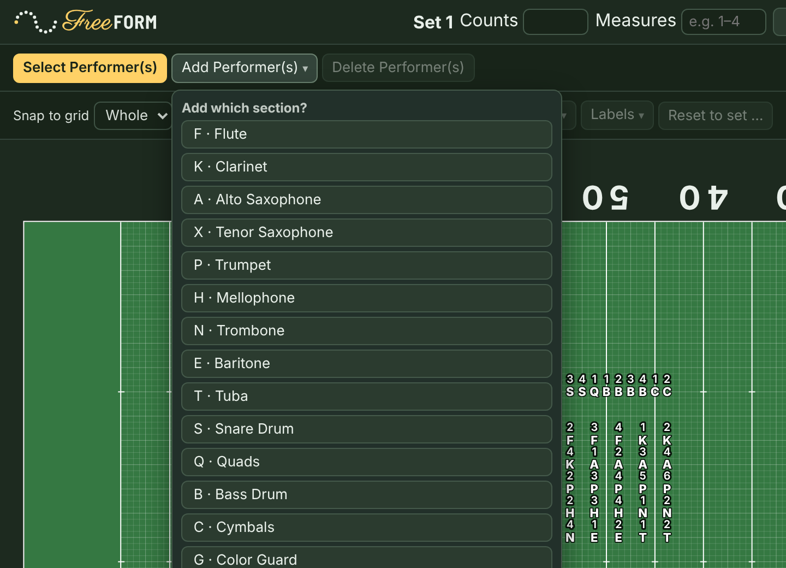

1. Click **Add Performer(s)** and pick a section.
2. Click the field wherever you want each one. They're numbered in order: P1, P2, P3, and so on.
3. Press **V** (or click **Select Performer(s)**) when you're done.

Performers are part of the whole show, so a performer you add appears in every set, on the same spot, until you move them.

**Names.** Each dot can have the name of the student who marches it. Click a dot and type the name at the top of **Selection** in the sidebar. The **Roster** list shows every dot and its name.

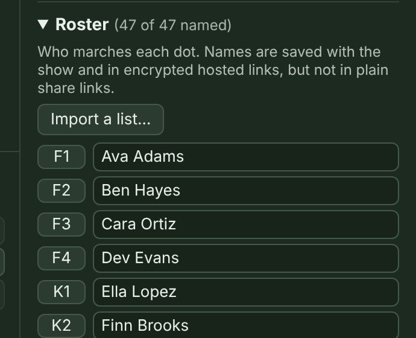

If you already have your roster in a spreadsheet, use **Import a list…** in Roster. Copy the cells from Excel and paste them, or choose a CSV file. FreeFORM reads the column headers (Name, or First and Last; Instrument or Section; Dot or Label), and you can fix any column it reads wrong. It shows you what will happen to every row before anything changes:

- A row with a dot (P4) names that dot, or adds it if it doesn't exist yet.
- A row with only an instrument names that section's next unnamed dot, or adds a new one.
- An instrument that doesn't match any section (say, a bassoonist who marches baritone) asks you which section those players go in.

New dots from an import wait in rows on the front sideline, centered on the 50. The whole import is one step, so a single Undo takes it all back.

Names are saved with the show and print on dot sheets. Plain share links leave them out, since anyone with the link could read them. Locked hosted links keep them (see [Send the show to your performers](#send-the-show-to-your-performers)).

## Select and move performers

With **Select Performer(s)** on:

- **Click** a performer to select them.
- **Shift-click** to add or remove performers from the selection.
- **Drag a box** on open field to select everyone inside it.
- **Drag** any selected performer to move the whole selection.

On a touch screen there's no Shift key, so turn on **Add to selection** in the sidebar's Selection area. Every tap or box then adds to what's already selected.

The Selection area also has **Select all** (⌘A, or Ctrl+A on Windows) and **Select a section…**, which picks every performer in that section. With two performers selected, it shows how many steps apart they are.

**Copying spots from one set to another.** Select performers, click **Copy spots** (⌘C, or Ctrl+C), go to another set, and click **Paste spots** (⌘V, or Ctrl+V). The same performers go back to the same spots. This is handy for a picture that comes back later in the show.

**Snap to grid** (in the toolbar) sets how dragging and adding land: on whole steps, half steps, or anywhere (free). If performers are already off the grid (after a rotate, a shape, or an import), select them and click **Apply** to round them onto it. FreeFORM warns you if two performers would land on the same spot.

**Reading coordinates.** Click one performer and the sidebar shows exactly where they are, in standard drill language.

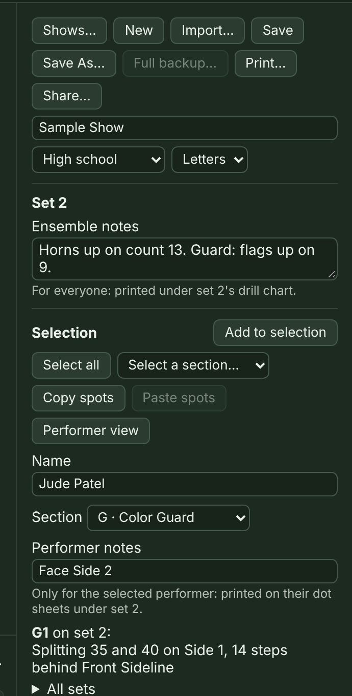

Coordinates read side to side first, then front to back, from the nearest yard line and the nearest sideline or hash, rounded to quarter steps. For example: "2 steps outside the Side 2 45, 2 steps in front of Front Hash," "Splitting 40 and 45 on Side 1," or "On the 50." Open **All sets** to see that performer's spot in every set.

**Placing someone exactly.** Open **Place exactly (this set)** under the coordinate, fill in the steps, inside or outside, the side and yard line, then the steps in front of or behind a sideline or hash, and click **Place**.

**Moves carry forward through holds.** When you move someone in a set, every later set where they were still standing on their old spot (holding) moves with them, up to the first set where you'd already put them somewhere else. So if you add performers, then place them in set 2, they stay there in sets 3, 4 and on until you move them again, and drill you've already written for later sets is never changed. This works the same for dragging, shapes, flips, rotating and stretching, snapping, and **Place exactly**.

**Reset to set** in the toolbar puts the selected performers back where they were in the set before, so you can start their move over.

## Sets, counts, and the timeline

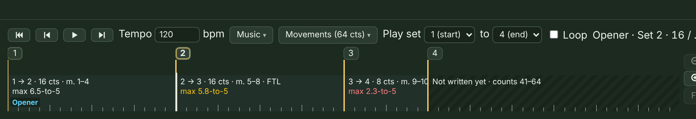

A set is one picture of the drill, and the move into it takes a number of counts. Set 1 is the opening set, so it has no move into it.

- **+ Add set** (top bar) adds a set 16 counts after the one you're on, and the sets after it move along. The new set starts as a copy of the one you were on, so you only move the people who move.
- Change a set's **Counts** and **Measures** in the top bar. New counts take effect when you press Enter or tap away, so the set doesn't jump around while you type. Type measures the way the score numbers them (a pickup bar is m. 1).
- **Delete set** removes the set you're on. The sets always stay numbered in order: delete set 7 of 8 and the old 8 becomes 7. Adding a set in the middle moves the later ones up a number the same way. Sub-sets keep their place after the set before them and stay lettered in order (the old 8A becomes 7A).
- **Click a set's button** on the timeline to go to it, or click any count to see where everyone is on that count.
- **Drag a set's button** to move it to a different count. The sets around it stay where they are.

Each move on the timeline shows its counts, measures, and the biggest step anyone takes (colored if it's too big, see [Step-size warnings](#step-size-and-too-close-warnings)).

The timeline scrolls sideways for a long show. Use the mouse wheel or a swipe over it, or right-drag. The magnifying glasses at the right end zoom the timeline in and out, and **Fit** shows the whole show.

**Movements: laying out the show by counts first.** If you know your music's length before you write, open **Movements** (under the field, beside Music) and type each tune's total counts.

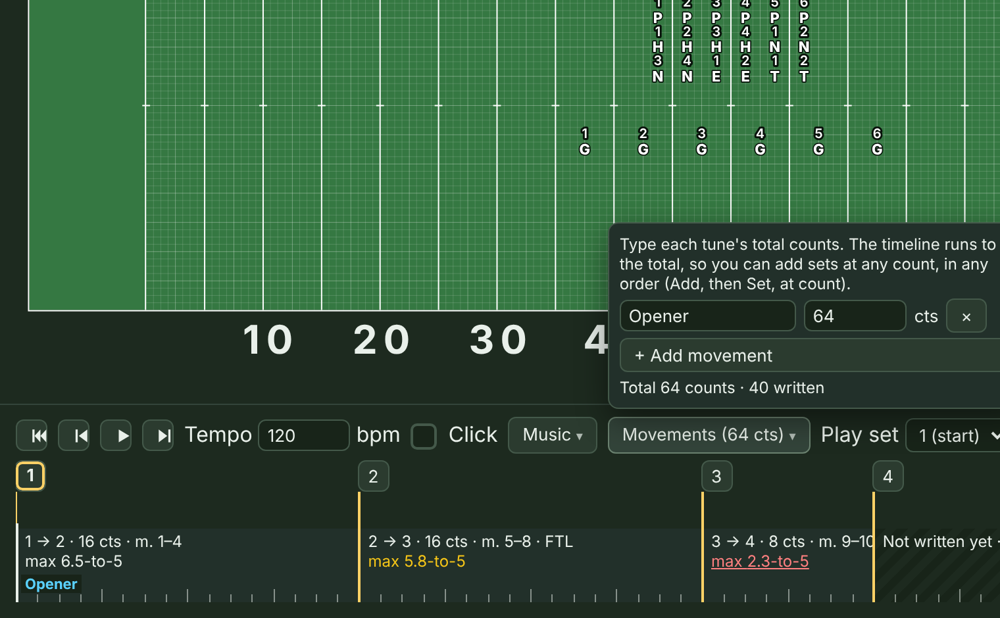

The timeline then runs the full length, with the part you haven't written yet striped *Not written yet*. To add a set at a particular count, click that count on the timeline and press **+ Add set**, or type the count in the **at count** box. No other set moves. A set added in the middle of a move splits it and gets a sub-set name (1A after 1), the way Pyware names them.

## Shapes: lines, arcs, curves, circles, polygons, stars, spirals, blocks, and letters

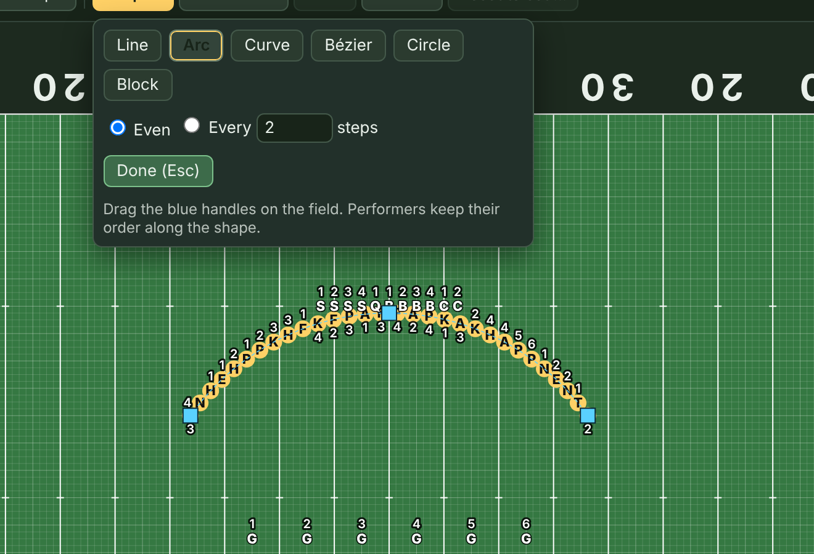

1. Select the performers you want in the shape.
2. Open **Shape** and pick **Line**, **Arc**, **Curve**, **Bézier**, **Circle**, **Polygon**, **Star**, **Spiral**, **Block**, or **Letters**. Or press its letter (see [Keyboard shortcuts](#keyboard-shortcuts)).
3. Drag the blue handles on the field to adjust the shape. Choose **Even** spacing, or **Every** so many steps.
4. Click **Done** (or press Esc) when it looks right.

FreeFORM decides who goes to which spot by keeping total travel from the previous set as short as it can, so the paths don't cross. Curves can take extra points (**+ Curve point**) and Béziers extra segments (**+ Segment**). Bézier joints stay smooth unless you hold Option (Alt on Windows) while you drag a handle. Blocks also take a number of **Columns**.

**Polygons** are regular: every side is the same length. Set the number of **Sides** (3 for a triangle, 4 for a diamond, 6 for a hexagon). A polygon has two handles: the center, and a corner. Drag the corner to size the polygon and turn it.

**Stars** have three handles: the center, a point, and an inside corner. Drag the point to size the star and turn it. Drag the inside corner toward the center for long, thin points, or away for short, fat ones. It stays on its corner as you drag. Set the number of **Points**, or type how deep the inside corners sit in **Inner**, as a percent of the distance from the center to the points. Performers go evenly around the outline, starting at the corner under the handle. To put someone on every corner, use a number of performers that's a multiple of the corners (5, 10, 15 for a 5-sided polygon; 10, 20 for a 5-point star, which has 10 corners).

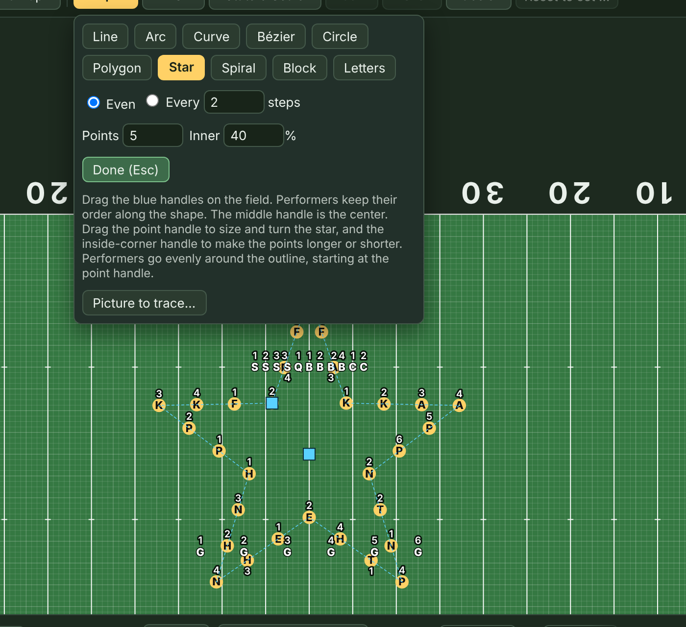

**Spirals** start in the center and wind out to the outer end. The first handle is the center and the second is the outer end. Set the number of **Turns**, and click the direction button to wind it **Counterclockwise** or **Clockwise**. The coils stay the same distance apart all the way out. Spacing is measured in a straight line from one performer to the next, so performers near the tight center get the same interval as everyone else. If the coils get closer than 2 steps, FreeFORM warns you, because performers on neighboring coils would be too close. Use fewer turns or make the spiral bigger.

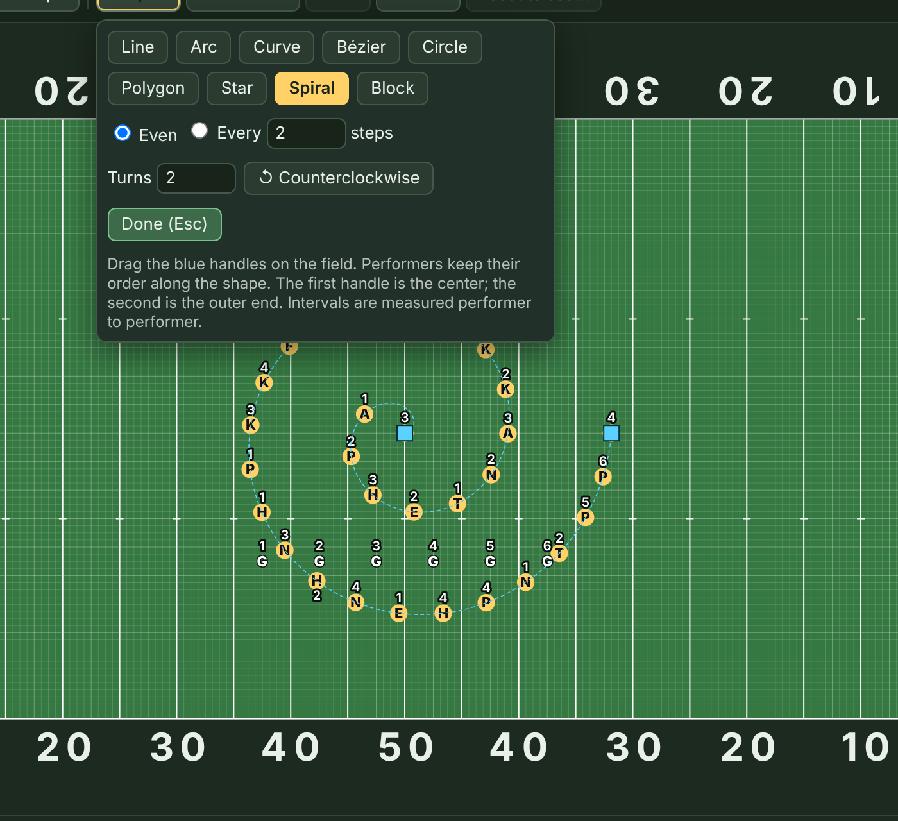

**Letters** spell a word with performers. Type it in **Spell**: capital letters, numbers, hyphens, and spaces. The word fills the box between the two handles, and it starts as wide as the letters need, so they keep their shape. Drag the handles to make it bigger or smaller. Performers are shared out along the strokes, more on the long ones, and every letter reaches its corners. A letter reads best with about 8 to 12 performers, so a short word works better than a long one.

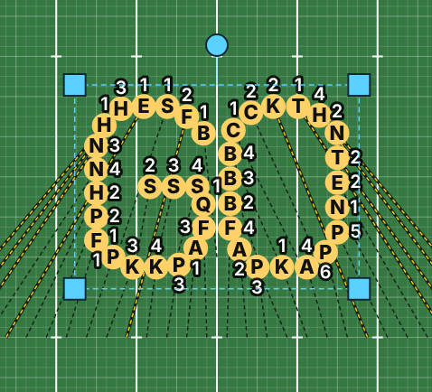

**Tracing a picture.** To copy a logo or a sketch onto the field, open **Picture to trace** in the sidebar and click **Add a picture…**. It shows under the field, see-through. Set how **Wide** it is in steps, where it sits (**Across** is steps from the 50, **Up** is steps from the front sideline), and how strong it shows with **See-through**. Then place performers on it by hand or with the shapes. The picture stays in the browser you added it in: it isn't saved in the show file, printed, or sent to phones. **Remove** takes it away.

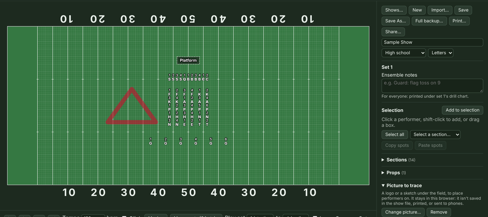

## Rotate, stretch, and flip

Select two or more performers and a dashed frame appears around them.

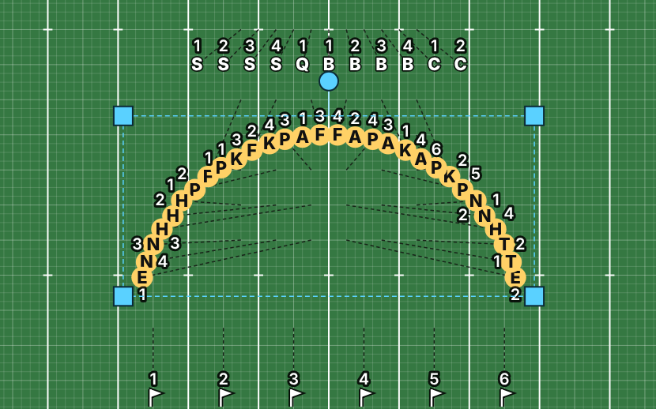

- **Drag the round knob** above the frame to rotate the selection around its center. It lands on whole degrees and pulls toward multiples of 15°, so 45° and 90° are easy to hit.
- **Drag a corner** to stretch. Drag sideways to make the group wider or narrower, up or down to make it deeper or shallower, or diagonally for both. Each direction pulls toward 100%, so a slightly crooked sideways drag won't change the depth.

The amount shows in the bottom-left corner of the field while you drag, and each drag is one Undo. Stretching follows the field's lines (side to side and front to back), even after you've rotated a group.

The **Transform** menu has the rest:

- **Flip across the 50** swaps Side 1 and Side 2, and **Flip front ↔ back** swaps front and back.
- **Copy Side 1 → 2** (or 2 → 1) gives the other side the mirror image. FreeFORM pairs each performer with the one in the mirror-opposite spot.
- **Rotate & scale** turns the selection by a typed number of degrees, and **Expand** and **Contract** scale it evenly by a typed percent. **Around** picks what it turns around: the center, or one of the selected performers. Pick the performer on the end of a line for a gate turn.

Rotating or stretching usually leaves performers between grid steps. Use **Snap to grid → Apply** if you want them back on whole or half steps.

## Follow-the-leader

In a follow-the-leader (FTL) move, the performers march the leader's path in order, instead of each going straight to their spot.

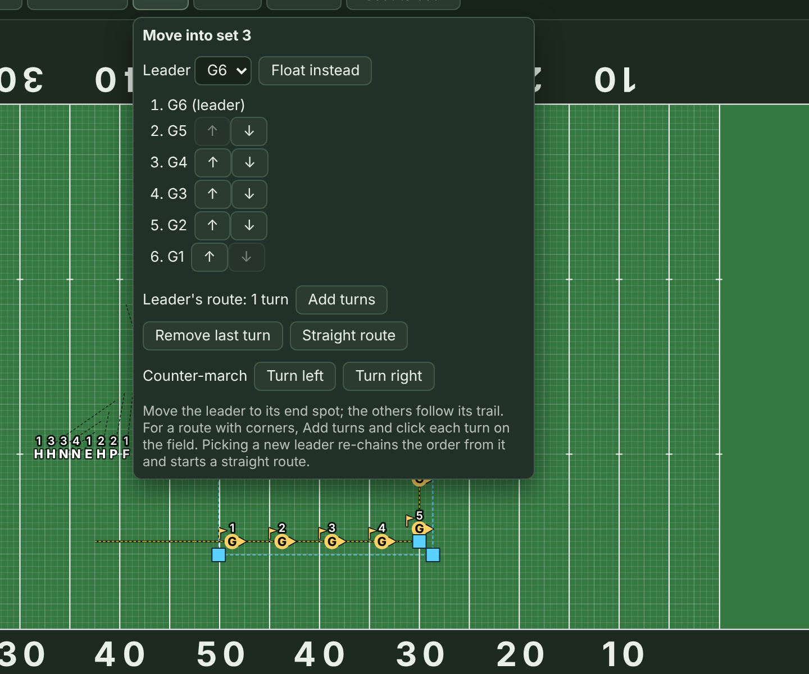

1. Go to the set the move ends on, and select the group.
2. Open **FTL**, pick the **Leader**, and put the others in order with the arrows.
3. Drag the leader to their end spot. Everyone else follows the trail.
4. For a route with corners, click **Add turns**, then click each turn on the field in marching order. Press Esc when you're done.

With the group selected, each turn has a blue handle you can drag. **Remove last turn** and **Straight route** take turns back out, and **Float instead** turns FTL off for that group. Turns move with the group when you drag, flip, rotate, or stretch it, and **Copy Side 1 → 2** copies an FTL group to the other side.

Everyone in an FTL move covers the leader's whole route at one steady step size, so a turn never makes anybody take a giant step.

**Counter-march.** Make an FTL group from a file, with the leader at the front of the file. Then click **Turn left** or **Turn right** next to **Counter-march**. The leader turns into the next lane, one step over, and marches back past the file. Everyone follows, so the file ends up reversed, one step beside where it started. Check the step size, since the leader marches the whole length of the file.

## Step-offs and turning moves

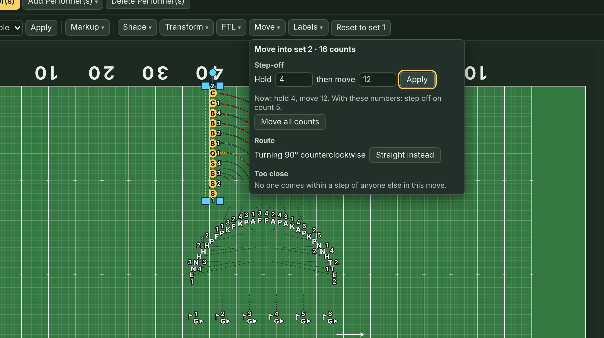

The **Move** menu (in the toolbar) is about the move into the set you're on.

**Delayed step-offs.** Not everyone has to move on count 1. Select the performers, open **Move**, type the counts to **Hold** and the counts to **then move**, and click **Apply**. Hold 4, then move 12 means they stand still for 4 counts, step off on count 5, and arrive on count 16. If the two numbers add up to less than the move's counts, they hold at the end. **Move all counts** puts them back to stepping off on count 1. They take one step size the whole time they move, and the step-size warnings count only the counts they move.

**Turning moves.** When you rotate a group, its move into the set is a straight line for each performer by default, so a block turning 90° shrinks through its middle on the way. To march it as a real turn, select the group, open **Move**, and click **Turn as a group**. FreeFORM finds the turn that takes the group from its old spots to its new ones, and each performer marches an arc around it, at one step size. A gate turn on the end of a line keeps the end performer standing still. **Straight instead** goes back to straight lines. Rotate the group first (with **Transform** or the knob on the field); a group that only slides has no turn to march.

A delayed step-off and a turning move work together: hold 4, then turn in 12, for example.

## Facing and equipment

Select performers, go to a set, and pick which way they face from **Facing** in the sidebar's Selection area: **Front**, **Back**, **Side 1**, **Side 2**, or one of the four diagonals (**Front-Side 2** and so on). Front is toward the front sideline, where the box is.

A small pointer beside each dot shows which way it faces, on the field, on printed charts, and on phones. A facing carries on into later sets until you change it, so you only set it where it changes. **As in the set before** takes back a change. Performers you never set have no pointer.

Dot sheets say "Face Side 2" on the set where a performer's facing changes, and the phone view shows "facing Side 2" with their spot and "face Back" with their next set when it's about to change.

**Guard equipment.** **Carries** (just under **Facing**) works the same way: pick **Flag**, **Rifle**, or **Saber** on the set where they pick it up, and **Nothing** where they put it down. A small flag, rifle, or saber shows beside each dot that carries one, on the field, on printed charts, and on phones. Dot sheets say "Flag" or "Put down equipment" on the set where it changes, and the phone says "pick up rifle" with the next set.

## Props

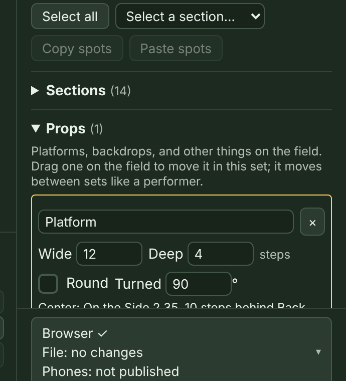

Props are things on the field that aren't performers: a platform, a backdrop, a ramp. Open **Props** in the sidebar and click **+ Prop**. It starts 8 steps wide and 4 deep on the 50, in every set.

- Type its name, and set how **Wide** (side to side) and **Deep** (front to back) it is, in steps. Check **Round** for an oval or circle.
- **Drag it on the field** to move it in the set you're on. Like a performer, it moves into later sets where it was still standing on its old spot, and it rolls from spot to spot between sets.
- **Turned** turns it in this set, in degrees counterclockwise. Between sets it turns the short way.
- Click it on the field to pick it (performers standing on it get picked first), and press Delete or click **×** to remove it from the whole show.

Props show on the field, on printed charts, and on phones.

## Step-size and too-close warnings

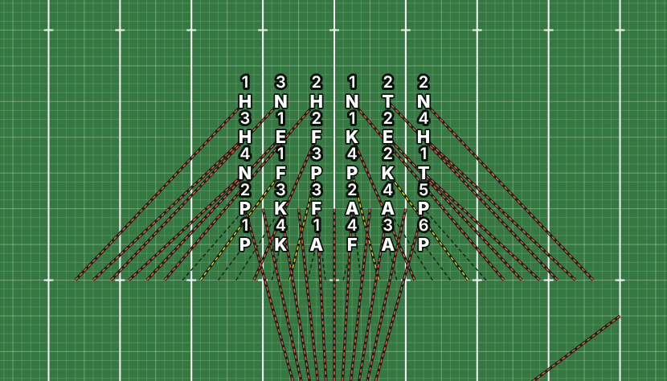

FreeFORM checks every move against the counts it has:

- **Yellow** means someone's step is bigger than a 6-to-5.
- **Red** means it's bigger than a 4-to-5, which is about as big a step as anyone should take.

The colors show on the path lines on the field and in the timeline's "max" readout for each move. To fix a red move, add counts, shorten the distance, or split the move with a sub-set.

**Too close.** FreeFORM also checks every half count of every move for two performers less than a step apart, even if they're fine at both ends. The timeline shows how many pairs come too close in each move ("2 too close" in red). Open **Move** to see who they are, how close they get, and on what count. **Select** picks the pair so you can fix them, by spreading their spots, giving one a delayed step-off, or changing who goes to which spot.

## Dot labels

FreeFORM keeps labels from overlapping each other or covering another dot. Each one sits above its dot, or below, beside, or on a diagonal when that spot is taken. In a tight block, some labels hide until you zoom in.

To place labels yourself, select performers, open **Labels**, and click a direction on the compass for the current set. The center **A** goes back to automatic, and **Hide** hides them. For a curve of three or more performers, **Inside curve** and **Outside curve** point every label toward or away from the curve's center.

Labels hide while a show plays (they'd jump around) and come back when you stop. Printed charts always show every label, with a thin leader line when one has to move away from its dot to find room.

## Markup and notes

**Markup** (in the toolbar) puts notes on the field for the current set only:

- **Text**: click the field and type. (Press **T** as a shortcut.)
- **Arrow**: drag from where the arrow starts to where it points.
- **Draw**: drag to draw freehand.

Click a piece of markup to select it, drag it to move it, and press Delete to remove it.

There are two kinds of written notes in the sidebar:

- **Ensemble notes** belong to a set and print under that set's drill chart, for everyone.
- **Performer notes** belong to the selected performers and print on their dot sheets for that set ("Slide L, horns 45").

## Play it back

The play controls are at the left end of the timeline: back to the start, back one count, play or pause, and forward one count.

- Play starts where you are and goes forward. Pick a set, then press Play (or Space).
- Set the speed with **Tempo**.
- **Play set … to …** limits playback to a range of sets. Check **Loop** to repeat it.
- The left and right arrow keys step one count at a time (when no one is selected).

## Add your music

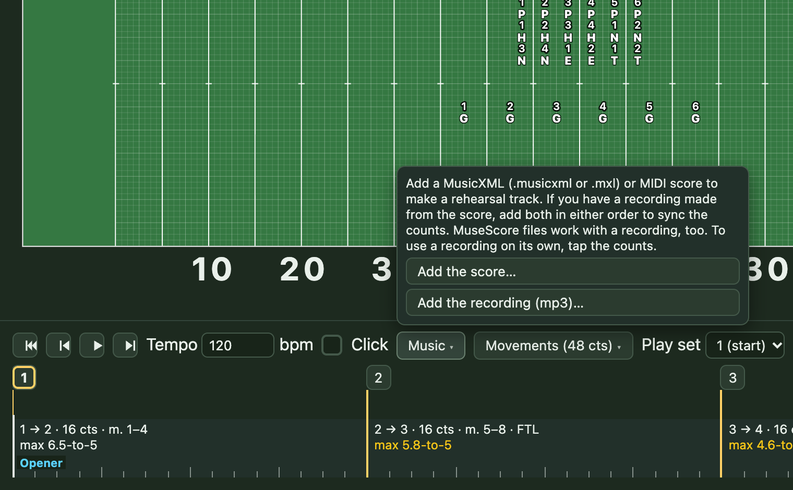

FreeFORM can play your drill along with the recording, so the moves line up with the music the way they will on the field.

**The easy way, with MuseScore:**

1. In MuseScore, export the score as audio (mp3).
2. In FreeFORM, open **Music** (beside Tempo) and click **Add the score (MuseScore)…**. Choose the `.mscz` file (MusicXML, `.mxl`, and MIDI work too).
3. Click **Add the recording (mp3)…** and choose the mp3 you exported.

You can do steps 2 and 3 in either order. Once both are in, FreeFORM takes the time of every count from the score, including meter changes, tempo marks, and fermatas, and places each set's counts in the measures you typed for it. It warns you if the recording's length doesn't match the score (usually a sign you picked the wrong file). Bars that no set covers, like a G.P. or an intro, get a hold sub-set (4A) so everyone stands still through them.

**With any recording, by tapping:** add just the recording (mp3, m4a, or wav), then choose **Tap counts…**. FreeFORM plays it from the top while you press Space on every count, starting with count 0 (set 1). You can undo a tap, pause, or start over. To fix part of it later, set **Redo from count** first.

When the counts are in, Play follows the music, rubato and all, and the recording's waveform shows along the bottom of the timeline. Uncheck **Play with music** to go back to the Tempo setting.

The recording stays in your browser. It isn't saved in the `.freeform` file, but the counts are, so on another computer you can add the same recording again and everything lines up.

## Print dot sheets and drill charts

Click **Print…** in the sidebar.

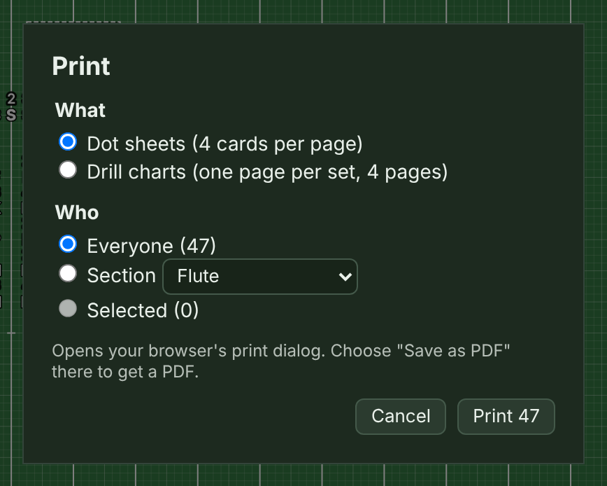

Choose **Dot sheets** or **Drill charts**, and who to print for: **Everyone**, one **Section**, or the performers you have **Selected**. FreeFORM opens your browser's print dialog. To get a PDF instead of paper, pick **Save as PDF** there.

Dot sheets come four cards to a page. Each card has the performer's label, name, and section, then every set with its counts, measures, and coordinates. Under a set go any notes for it: a delayed step-off ("Hold 4, move 12"), a change of facing or equipment, and the performer notes.

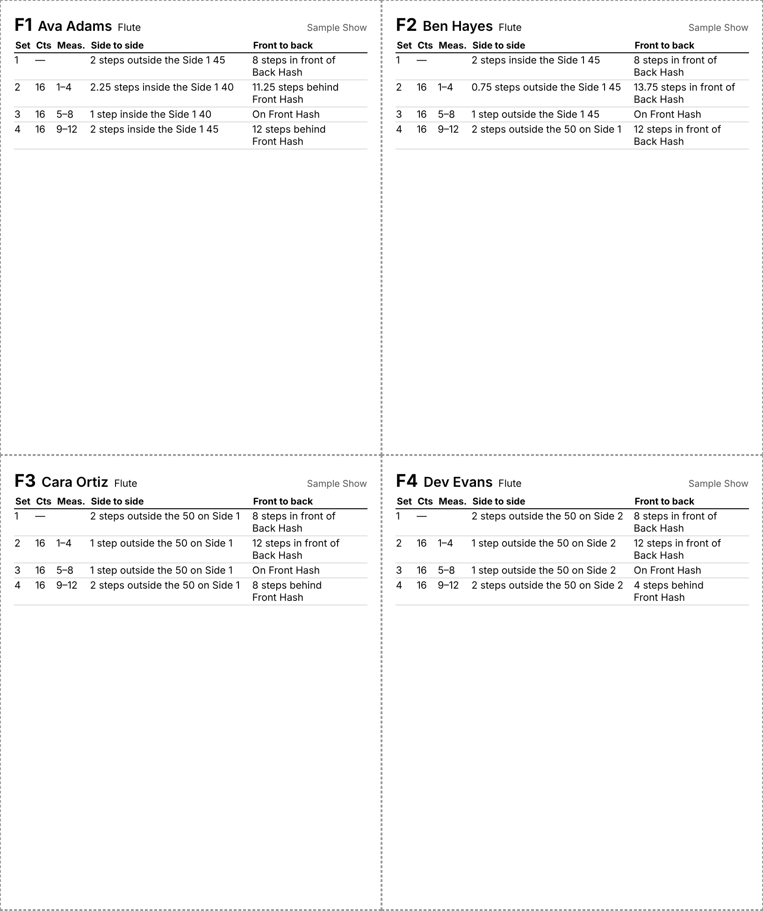

For bigger print, choose **1 per page, bigger, with a notes column** under **Layout**. Each performer gets a whole page, and the notes go in their own column.

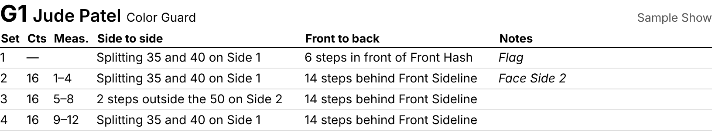

Drill charts are one page per set, with every dot labeled, the set's markup, props, and its ensemble notes underneath. They're black on white so they copy well. Sections with a color print as colored dots, which come out as shades of gray on a black-and-white printer.

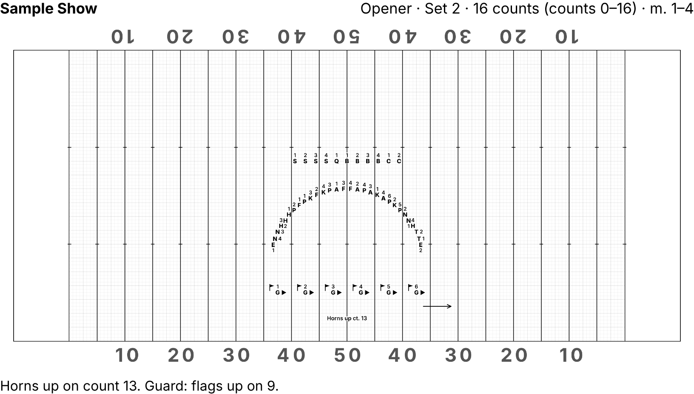

Check **Show the paths into each set** to add a thin dashed line from where each performer was in the set before, along the route they march (follow-the-leader trails and turning moves included).

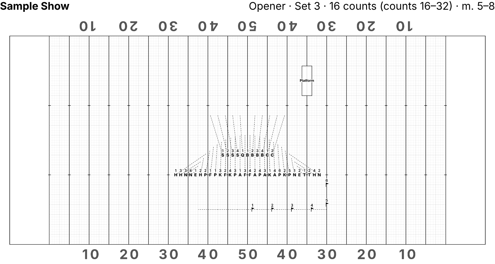

## Send the show to your performers

Click **Share…** in the sidebar.

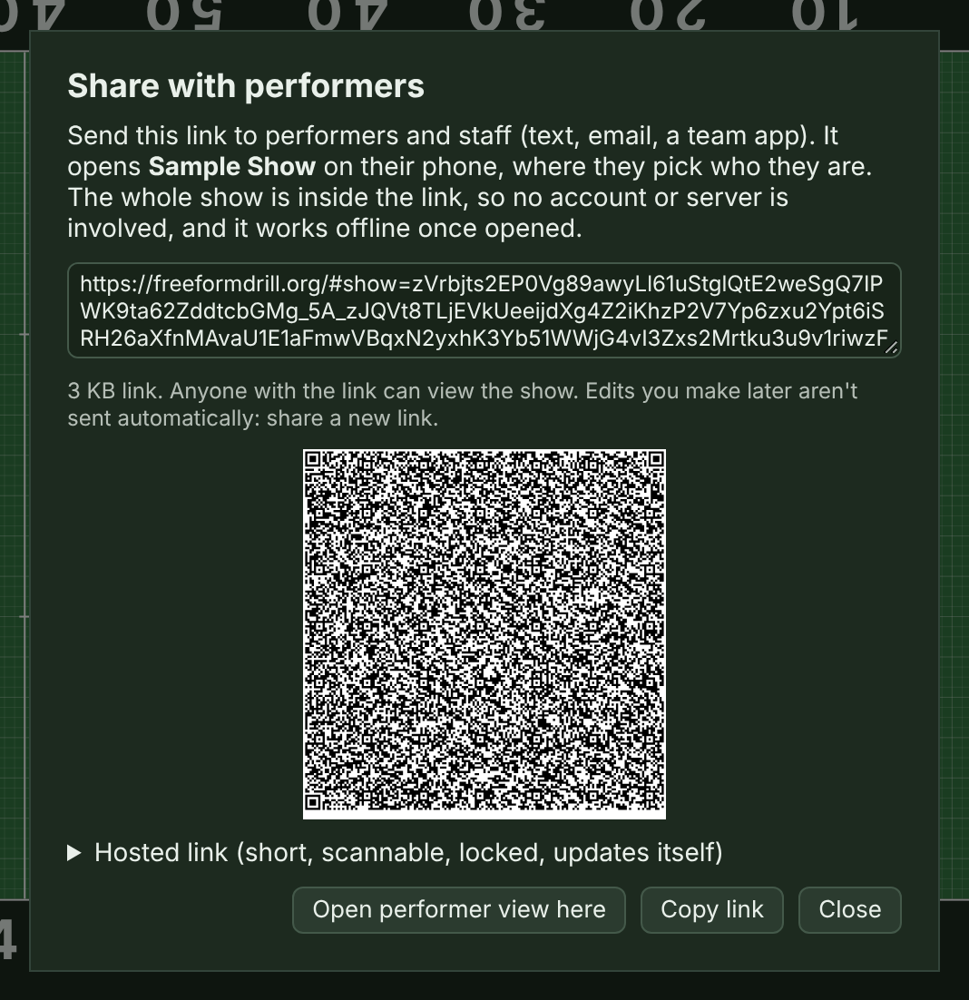

**Share links** are the quick way. The whole show is packed inside the link, so there's no server and no account involved. Text it, email it, or post it in your band's group chat. For a small show you also get a QR code you can put on a screen at rehearsal. Two things to keep in mind:

- Anyone with the link can see the show, so names are left out.
- Changes you make later aren't sent. After you edit, share a new link.

**Hosted links** are better for a real season. Open **Hosted link** in the Share dialog. FreeFORM makes a *locked* show file, encrypted in your browser, and you put that file online. The link that opens it is short, makes a QR code that scans easily, and keeps working when you update the show: performers' phones pick up your latest version the next time they open it online. The key that unlocks the file is only in the link, so whoever hosts the file can't read it. **The link is the password, so share it only with your band.** A locked file can carry names and, if you want, the music.

There are two ways to put the file online:

- **Publish to phones** does it in one click once you connect FreeFORM to a public GitHub repository of your own. (Public is fine, since the file is encrypted.) You'll need the repository's name and a fine-grained GitHub token that can write only to that repository (*Contents: Read and write*). Both stay in your browser. After that, **Publish update** replaces the file, and the link and QR code never change.
- **Or host the file yourself**: download the locked file and upload it anywhere that gives you a direct link to it. A GitHub repository works (upload the file, open it, and copy its **Raw** link). Paste that address into the box and FreeFORM makes your short link.

To cut off old links (say, a student leaves the program), clear the address and start over. Phones that already have the show keep their copy but get no more updates.

## What performers see on their phones

When a student opens your link on their phone, they pick who they are.

They can search by name, by dot (P4), or by section, and **Staff (whole band)** at the top shows everyone. FreeFORM remembers their choice, and the show keeps working offline once it's opened.

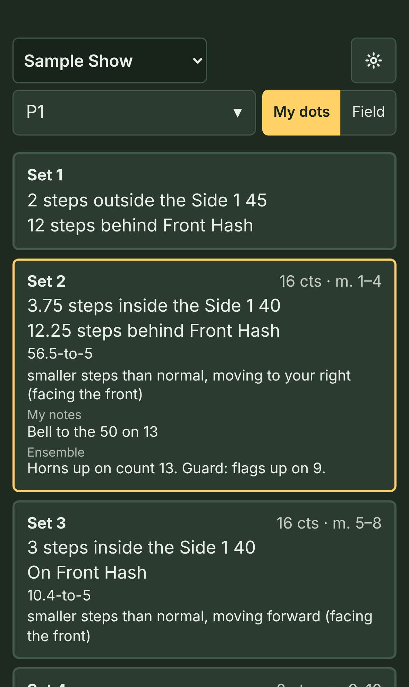

On the performer screen:

- **My view** follows their dot through each move. **Whole field** shows everything, and pinch-zoom works in both.
- **Director view** shows the field the way the editor does. Tap it to switch to **Facing front**, which turns the field around to match what they see facing the audience.
- Under the field they see their spot now and in the next set, with counts, measures, and step size, plus their notes and the ensemble notes.
- **Around you** lists their nearest neighbors (up to four, within 10 steps) and where each one is, like "P5 · 4 steps toward Side 1."
- They can play at any tempo, step count by count, scrub, or tap a set number to jump to it. If the show has music, Play follows it, and **♪ Music** switches back to a tempo.

Students can add FreeFORM to their home screen. In the home-screen app, they open a show with **Scan QR code** or by pasting the link.

On a computer or iPad, **Performer view** in the sidebar (or **Open performer view here** in the Share dialog) shows you the same screen, and **← Editor** takes you back.

## Using an iPad

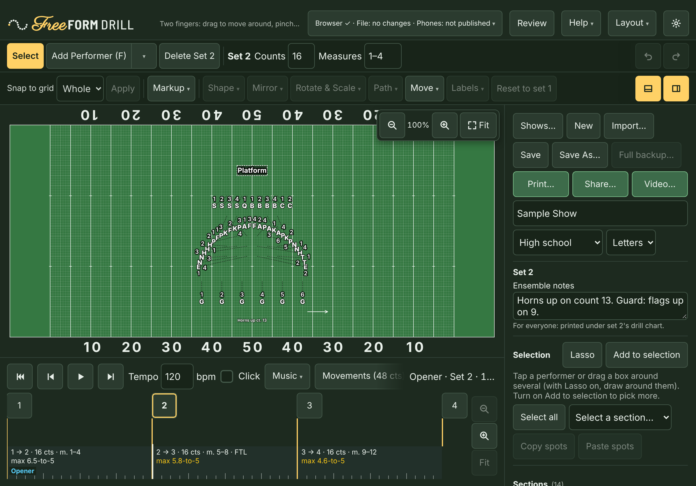

The editor works on an iPad the same way it does on a computer, with a few touch habits:

- **One finger** does whatever the tool does: tap to select or add, drag to move, drag on open field for a box.
- **Two fingers** pan and pinch-zoom the field. If a second finger lands while the first one has started something, FreeFORM takes that back and moves the view instead.
- **With an Apple Pencil**, the Pencil does the editing. Once you've used it on the field, a single finger or a palm resting on the screen does nothing there, so you can rest your hand while you work. Two fingers still pan and zoom, and they never undo what the Pencil just did. To go back to editing with your finger, reload the page.
- Turn on **Add to selection** to build up a selection without a Shift key.
- On the timeline, tap a set to go to it and swipe to scroll. To move a set to a new count, touch and hold its button until it lifts, then drag. That way a swipe can't move a set by accident.
- On an iPad held upright, the sidebar starts hidden. The sidebar button opens it over the right side of the field.
- For more room while you write drill, hide the timeline, the sidebar, or both. The timeline button (a window with a bar along the bottom) and the sidebar button (a window with a bar on the right) are at the right end of the toolbar, and each one shows and hides its panel. The field grows to fill the space and zooms back out to fit. You can still change sets with the arrows at the top, and the keyboard shortcuts still work.

With a keyboard attached, the [keyboard shortcuts](#keyboard-shortcuts) work too.

## Saving, backing up, and opening files

- **Autosave**: every change is saved in your browser right away.
- **Export** downloads the show as a `.freeform` file. This is your real backup, because the autosave lives in only that one browser. Export before big changes and at the end of every session.
- **Import…** opens a `.freeform` file (older `.freeform.json` files too). It replaces the current show, and Undo brings the old one back.
- **Pyware 3D files (`.3dj`)**: Import… also opens these. You get the sets with their counts and names, measures and notes, sections from Pyware's symbols, label positions, and the roster names. Moves that aren't straight in Pyware (follow-the-leader, rotations, delayed step-offs) come in count by count, with even steps. Drawn markup and the 3D figures don't come over.

## Keyboard shortcuts

| Do this | Press |
|---|---|
| Select tool | V |
| Add performer tool | A |
| Text note tool | T |
| Shape the selection (2 or more): Line, Arc, cUrve, Bézier, circle (O), Polygon, star (X), Spiral, blocK, Letters (W, for word) | L, R, U, B, O, P, X, S, K, W |
| Play or pause | Space |
| Back or forward one count (no one selected) | ← or → |
| Move the selection 1 step | ← → ↑ ↓ |
| Move the selection 4 steps | Shift + arrow |
| Move the selection half a step | Option (Alt) + arrow |
| Zoom the field in or out | ⌘+ or ⌘− (Ctrl on Windows) |
| Fit the whole field | F, or ⌘0 (Ctrl+0) |
| Select everyone | ⌘A (Ctrl+A on Windows) |
| Copy or paste the selection's spots | ⌘C or ⌘V (Ctrl+C or Ctrl+V) |
| Delete the selection (asks first) | Delete |
| Undo | ⌘Z (Ctrl+Z on Windows) |
| Redo | ⇧⌘Z (Ctrl+Y or Ctrl+Shift+Z on Windows) |
| Close a menu, then clear the selection | Esc |
| Move around the field | Scroll, or right-drag |
| Zoom | Pinch, or ⌘/Ctrl + scroll |

Arrows move the selection the way it looks on screen: ↑ is toward the back sideline. Shortcuts don't fire while you're typing in a box.

## If something goes wrong

**My show is gone.** Make sure you're in the same browser on the same computer you used before. The autosave doesn't follow you to other browsers or devices. If you exported the show, use **Import…** to open that file.

**I made a mistake.** Undo (⌘Z or Ctrl+Z) works for every edit, including deleting performers, importing a show, and starting a new one.

**A student's phone shows an old version.** A share link holds the show as it was when you made it, so send a new one. A hosted link updates itself when the phone opens it while online. If you changed the file online but the phone hasn't caught up, have the student close the show and open it again while connected.

**The browser says it's too old.** Update your browser, or on an iPad, update iPadOS to 16.4 or later.

**FreeFORM hit an error.** The error page has **Download autosaved show**, so you can save your work before you reload. If it keeps happening, please [open an issue](https://github.com/Tillerdawg/Freeform_2/issues) and say what you were doing.
