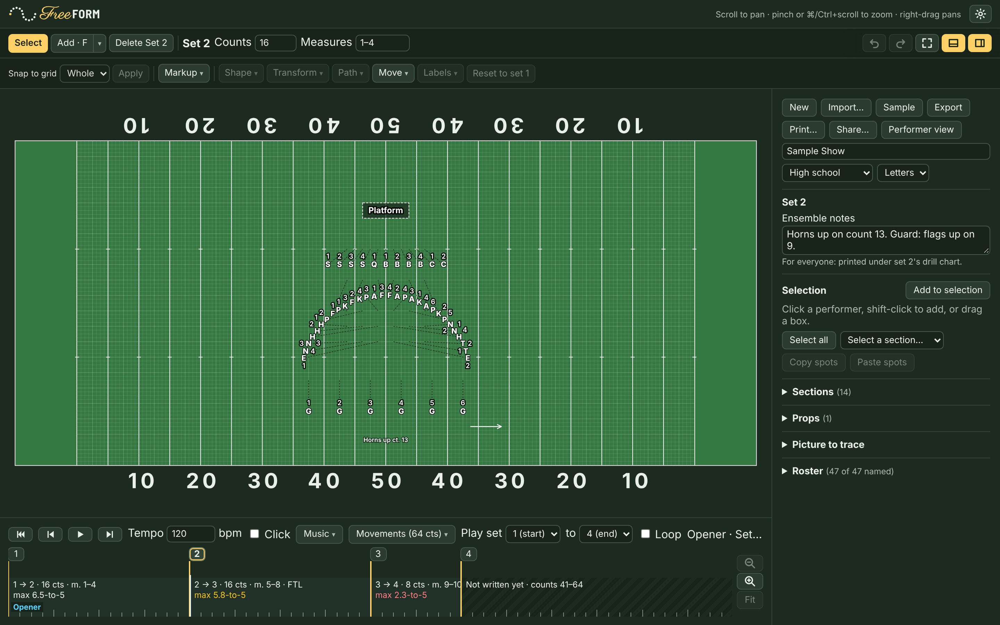
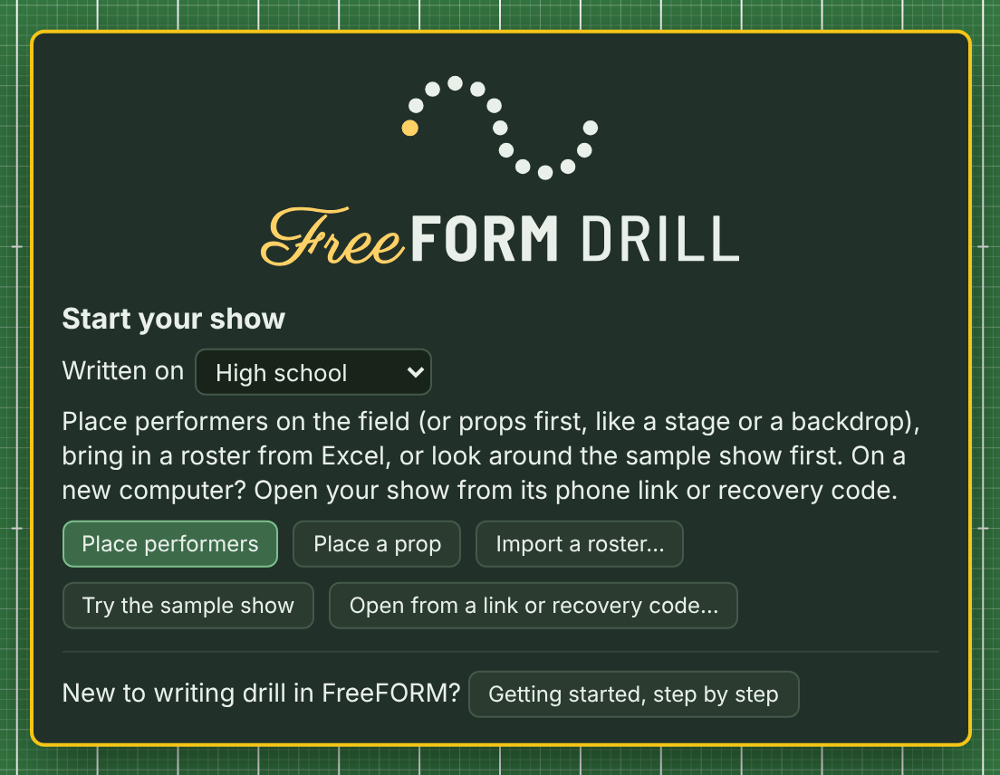
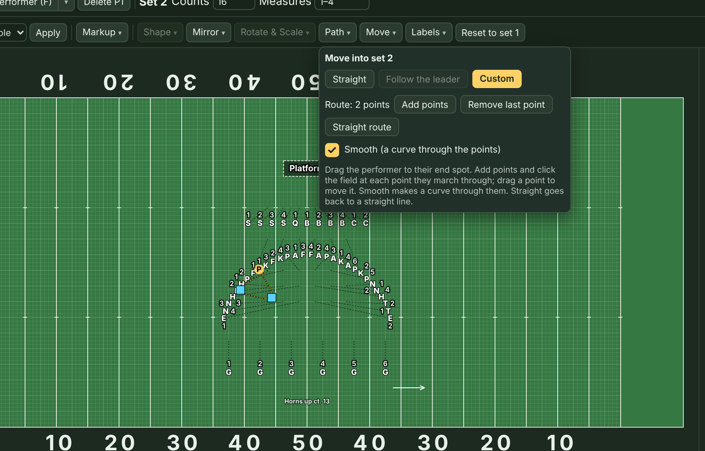
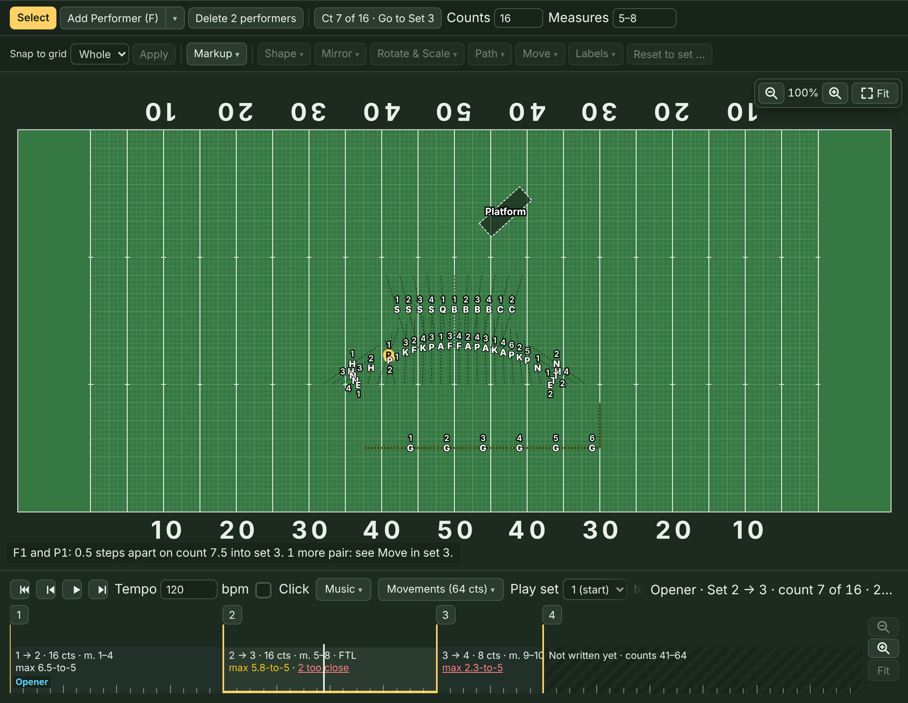
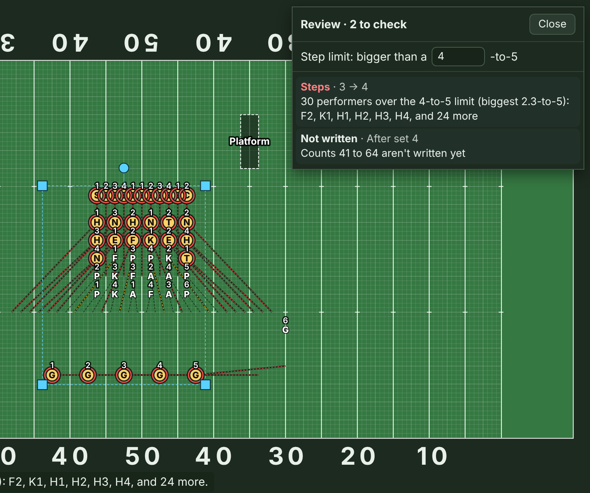
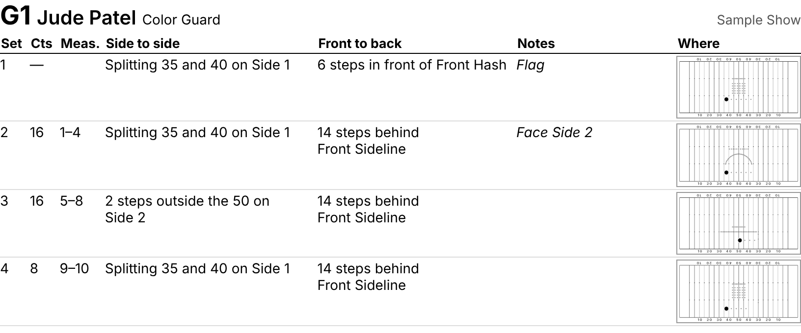
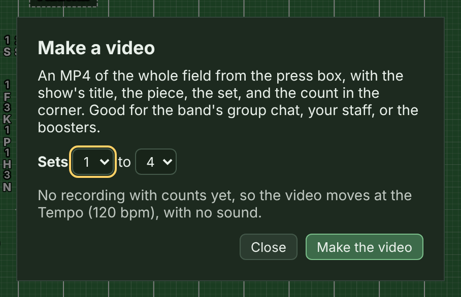
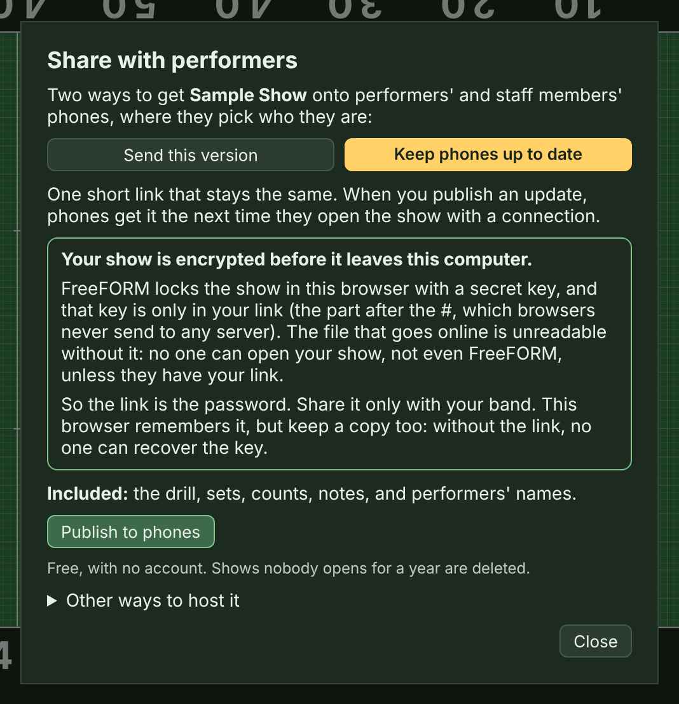
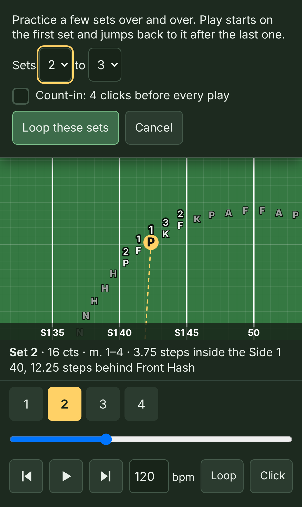
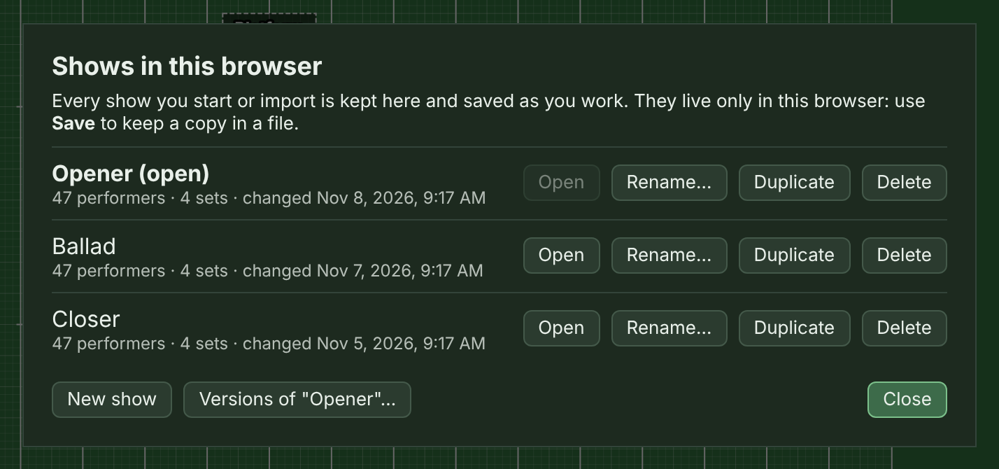

# How to use FreeFORM

This guide walks you through writing a show in FreeFORM, from an empty field to dot sheets in your students' hands and the drill on their phones. It's written for band directors and drill writers. You don't need to have used Pyware or UDB before, but if you have, most of this will feel familiar.

FreeFORM runs in your web browser. The front page, <https://freeformdrill.org/>, says what it is; click **Open the editor** there, or go straight to <https://freeformdrill.org/app/>. There's nothing to install and no account to make. (Share links made before the editor moved to /app/ still work.)

The pictures in this guide come from a small sample show (47 performers, 4 sets) that ships with the code. Your screen will look the same, just with your own drill on it.

## Contents

1. [Before you start](#before-you-start)
2. [A quick tour of the editor](#a-quick-tour-of-the-editor)
3. [Set up a new show](#set-up-a-new-show)
4. [Add performers](#add-performers)
5. [Select and move performers](#select-and-move-performers)
6. [Sets, counts, and the timeline](#sets-counts-and-the-timeline)
7. [Shapes: lines, arcs, curves, circles, polygons, stars, spirals, blocks, and letters](#shapes-lines-arcs-curves-circles-polygons-stars-spirals-blocks-and-letters)
8. [Rotate, stretch, and flip](#rotate-stretch-and-flip)
9. [Paths: straight, follow the leader, and custom](#paths-straight-follow-the-leader-and-custom)
10. [Step-offs and turning moves](#step-offs-and-turning-moves)
11. [Props](#props)
12. [Step-size and too-close warnings](#step-size-and-too-close-warnings)
13. [Review the whole show](#review-the-whole-show)
14. [Dot labels](#dot-labels)
15. [Markup and notes](#markup-and-notes)
16. [Play it back](#play-it-back)
17. [Add your music](#add-your-music)
18. [Print dot sheets and drill charts](#print-dot-sheets-and-drill-charts)
19. [Make a video](#make-a-video)
20. [Send the show to your performers](#send-the-show-to-your-performers)
21. [What performers see on their phones](#what-performers-see-on-their-phones)
22. [Using an iPad](#using-an-ipad)
23. [Saving, backing up, and opening files](#saving-backing-up-and-opening-files)
24. [Keyboard shortcuts](#keyboard-shortcuts)
25. [If something goes wrong](#if-something-goes-wrong)

## Before you start

You'll want a computer or an iPad to write drill. FreeFORM needs a current version of Chrome, Edge, Firefox, or Safari, or iPadOS 16.4 or later (any iPad from 2017 on). If your browser is too old, you'll get a page that says so.

Phones only get the performer view. That's on purpose: a phone screen is too small to write drill on, but it's perfect for a student checking their spot.

**On a school Chromebook,** check before you rely on the autosave. Many schools set Chromebooks to clear everything in the browser when you sign out, which would take your shows with it. Save to a file (Google Drive works) at the end of every session, and use **Import…** to open it next time.

One thing to know up front: **your shows are saved in the browser you're using.** FreeFORM saves every change automatically, but only on that computer, in that browser. If you clear your browser data, or switch from Chrome to Safari, your shows won't be there. Use **Save** often to keep a file you control (see [Saving, backing up, and opening files](#saving-backing-up-and-opening-files)).

## A quick tour of the editor

From top to bottom:

- **The top bar** has the logo, a reminder of how to move around the field, **Help** (the **How-to guide**, which opens this guide in a new tab at freeformdrill.org/guide/, **Try the sample show**, **Send feedback**, which opens a page on GitHub to report a problem or suggest something, **Support FreeFORM**, a tip jar on Ko-fi (FreeFORM is free either way), and **About FreeFORM Drill**, the front page), **Layout** (**Sidebar on the left** or right, and **Timeline at the top** or bottom; this browser remembers your choice), and at the far right the sun/moon button, which switches between dark mode and light mode. Until you click it, FreeFORM follows your computer's or iPad's own light or dark setting. The field looks the same either way.
- **The drill toolbar** has two rows. The first row has **Select**, **Add** (performers, a set, or a prop), and **Delete**, then the set you're on with its **Counts** and **Measures**. At the right end are Undo, Redo, Fit (zooms back out to the whole field), the timeline button, and the sidebar button. The second row has the tools for placing and moving performers: **Snap to grid**, **Markup**, **Shape**, **Transform**, **Path**, **Move**, **Labels**, and **Reset to set**.
- **The field** is in the middle. You're looking at it from the press box: the front sideline is at the bottom and Side 1 is on the left. Scroll to move around, and pinch (or hold ⌘ or Ctrl and scroll) to zoom.
- **The timeline** runs across the bottom. Each set has a numbered button, and each move between sets shows its counts, measures, and biggest step size.
- **The sidebar** on the right (or the left, under **Layout**) holds the show's file buttons (including **Shows…**, the list of every show in this browser), then **Print…** and **Share…** on a row of their own, the title, and hash marks; the current set's notes; whatever you have selected; and the **Sections** and **Roster** lists. The sidebar button (at the right end of the toolbar) shows and hides it.

## Set up a new show

Click **New** in the sidebar to start a show. The show you had open stays in this browser: **Shows…** opens it again (see [Several shows: Opener, Ballad, Closer](#saving-backing-up-and-opening-files)).

When the field has no performers, a note over it offers three ways to begin: **Place performers** opens the **Add** menu so you can pick a section and start clicking, **Import a roster…** brings in a list from Excel (see **Names** under [Add performers](#add-performers)), and **Try the sample show** opens a finished 47-performer show to look around in first. **Help** (in the top bar), then **Try the sample show**, opens the same show any time. It opens as a show of its own, so yours stays under **Shows…**.

1. **Name it.** Type the title in the box under the file buttons. It prints on every dot sheet and chart.
2. **Pick your field.** The menu under the title has **High school**, **College / DCI**, and **NFL** for a football field, plus **Basketball court** and **Custom floor** for indoor shows (more on those just below). For a football field FreeFORM draws the field the way drill software does, with whole-step hashes:

   | Level | Sideline to hash / hash to hash / hash to sideline |
   |---|---|
   | High school | 28 / 28 / 28 steps |
   | College / DCI | 32 / 20 / 32 steps |
   | NFL | 36 / 12 / 36 steps |

   If you change the hashes after you've written drill, FreeFORM asks whether performers should keep their places relative to the hashes (on the hash stays on the hash) or keep their exact spots on the field.

   **Indoor shows.** **Basketball court** draws a 94 by 50 foot court with its lines. **Custom floor** is a plain floor or tarp: type how **Wide** and **Deep** it is in feet. Indoors, coordinates read from the center line and the nearer front or back edge, like "3 steps Side 1 of center, 2.5 steps behind Front Sideline" on a court or "… behind Front Edge" on a floor. The step grid works the same as outside. If you switch a show you've already written onto a floor, performers keep their spots in steps, and FreeFORM tells you if any end up off the floor. **Place exactly** is for football fields only for now.

   
3. **Letters or dots.** By default each performer is drawn as their section letter with their number beside it (a P with a 4). Switch the menu beside the field to **Dots** if you'd rather see plain dots labeled P4.
4. **Check your sections.** Open **Sections** in the sidebar.

New shows start with Flute (F), Clarinet (K), Alto Sax (A), Tenor Sax (X), Trumpet (P), Mellophone (H), Trombone (N), Baritone (E), Tuba (T), Snare (S), Quads (Q), Bass Drum (B), Cymbals (C), and Color Guard (G). There's no front ensemble, since they usually stay put, but you can add one.

In the Sections list you can:

- Rename a section or change its letter. If two sections share a letter, FreeFORM flags them, since their labels would look the same.
- Give a section a color with the swatch. Its dots show in that color on the field, on phones, and on printed charts. **Clear colors** goes back to plain dots.
- Delete a section. If it has performers, you pick where they go. (New sections are added from **Add**; see below.)
- Reorder the list by dragging the dotted grip at the left of a row, or use **Sort** for score order, by letter, or by name. Dot sheets print in this order.
- Renumber a section with **#**: **Close the gaps** (X4, X5, X6 become X1, X2, X3), **Left to right** (Side 1 to Side 2), or **Front to back** (rank by rank), as they stand in the current set.

If your program always uses the same sections, set them up once and choose **Starting list → Use this list for new shows**. New shows in that browser will start with your list. **Back to FreeFORM's list** undoes it.

## Add performers

**Add** is two buttons in one. The **▾** part opens its menu, where you pick what to add: a set, a section's performers, or a prop. The main part repeats your last pick, and its name says what that is: **Add · P** places more trumpets, **Add Set** adds another set, and **Add Prop** adds another prop.

**New** drops you here: the field is blank, adding performers is on, and the **Add** menu is open.

1. Click **Add**'s **▾** and pick a section under **Performers**. For a section that isn't there yet (a drum major, a soloist), click **Create New Section**, type its name and letter, and click **Add**: it's made and picked in one step. Later, **Add · P** (or whichever section you used last) picks up where you left off, and so does the A key.
2. Click the field wherever you want each one. They're numbered in order: P1, P2, P3, and so on.
3. Press **V** or Esc (or click **Select**) when you're done.

Performers are part of the whole show, so a performer you add appears in every set, on the same spot, until you move them.

**Names.** Each dot can have the name of the student who marches it. Click a dot and type the name at the top of **Selection** in the sidebar. The **Roster** list shows every dot and its name.

If you already have your roster in a spreadsheet, use **Import a list…** in Roster. Copy the cells from Excel and paste them, or choose a CSV file. FreeFORM reads the column headers (Name, or First and Last; Instrument or Section; Dot or Label), and you can fix any column it reads wrong. It shows you what will happen to every row before anything changes:

- A row with a dot (P4) names that dot, or adds it if it doesn't exist yet.
- A row with only an instrument names that section's next unnamed dot, or adds a new one.
- An instrument that doesn't match any section (say, a bassoonist who marches baritone) asks you which section those players go in.

New dots from an import wait in rows on the front sideline, centered on the 50. The whole import is one step, so a single Undo takes it all back.

Names are saved with the show and print on dot sheets. Plain share links leave them out, since anyone with the link could read them. Locked hosted links keep them (see [Send the show to your performers](#send-the-show-to-your-performers)).

## Select and move performers

With **Select** on:

- **Click** a performer to select them.
- **Shift-click** to add or remove performers from the selection.
- **Drag a box** on open field to select everyone inside it.
- **Option-drag** (Alt-drag on Windows) on open field to draw a **lasso**: a freeform outline around the performers you want, for shapes a box can't fit, like one side of an arc. Everyone inside the outline is selected when you let go.
- **Drag** any selected performer to move the whole selection.

On a touch screen there's no Shift key, so turn on **Add to selection** in the sidebar's Selection area. Every tap, box, or lasso then adds to what's already selected. There's no Option key either, so turn on **Lasso**, next to it, and dragging on open field draws a lasso instead of a box. (Shift and Option work together too: Shift-Option-drag adds a lasso's performers to the selection.)

The Selection area also has **Select all** (⌘A, or Ctrl+A on Windows) and **Select a section…**, which picks every performer in that section. With two performers selected, it shows how many steps apart they are.

**Copying spots from one set to another.** Select performers, click **Copy spots** (⌘C, or Ctrl+C), go to another set, and click **Paste spots** (⌘V, or Ctrl+V). The same performers go back to the same spots. This is handy for a picture that comes back later in the show.

**Snap to grid** (in the toolbar) sets how dragging and adding land: on whole steps, half steps, or anywhere (free). If performers are already off the grid (after a rotate, a shape, or an import), select them and click **Apply** to round them onto it. FreeFORM warns you if two performers would land on the same spot.

**Dimming or hiding sections.** When the field is crowded, open **Sections** in the sidebar and click the first button on a section's row. It cycles **On**, **Dim** (drawn faint, with no labels), and **Off** (hidden). Dimmed and hidden performers can't be clicked, boxed, or picked by **Select all**, and their paths aren't drawn, so you can write the guard without grabbing the horns. **Show all** brings everyone back. This only changes your view in the editor, in this browser: printed charts and phones always show everyone.

**Reading coordinates.** Click one performer and the sidebar shows exactly where they are, in standard drill language.

Coordinates read side to side first, then front to back, from the nearest yard line and the nearest sideline or hash, rounded to quarter steps. For example: "2 steps outside the Side 2 45, 2 steps in front of Front Hash," "Splitting 40 and 45 on Side 1," or "On the 50." Open **All sets** to see that performer's spot in every set.

**Placing someone exactly.** Open **Place exactly (this set)** under the coordinate, fill in the steps, inside or outside, the side and yard line, then the steps in front of or behind a sideline or hash, and click **Place**.

**Moves carry forward through holds.** When you move someone in a set, every later set where they were still standing on their old spot (holding) moves with them, up to the first set where you'd already put them somewhere else. So if you add performers, then place them in set 2, they stay there in sets 3, 4 and on until you move them again, and drill you've already written for later sets is never changed. This works the same for dragging, shapes, flips, rotating and stretching, snapping, and **Place exactly**.

**Reset to set** in the toolbar puts the selected performers back where they were in the set before, so you can start their move over.

## Sets, counts, and the timeline

A set is one picture of the drill, and the move into it takes a number of counts. Set 1 is the opening set, so it has no move into it. A set's **Counts** are the counts of the move *into* it: 16 counts on set 3 means it takes 16 counts to get from set 2 to set 3.

**Between sets, you're previewing.** When the playhead is partway through a move, the field shows where everyone is on that count, but you can't move or add performers there: edits go on a set. The toolbar shows this in place of the set name, for example **Ct 6 of 16 · Go to Set 3**. Click it to jump to set 3. If you try to drag or add a performer mid-move, a note at the bottom of the field says the same thing.

- **Add**'s **▾**, then **Set**, adds a set 16 counts after the one you're on, and the sets after it move along. You're back on **Select** afterward, and the button now reads **Add Set**, so the next set is one click. The new set starts as a copy of the one you were on, so you only move the people who move.
- Change a set's **Counts** and **Measures** on the toolbar's first row, next to **Delete**. New counts take effect when you press Enter or tap away, so the set doesn't jump around while you type. Type measures the way the score numbers them (a pickup bar is m. 1).
- **Delete** with nothing selected removes the set you're on, after asking. (With performers, a prop, or markup selected, it deletes those instead. The button says what it will delete: **Delete Set 3**, **Delete P4**, **Delete 6 performers**, **Delete prop**, or **Delete markup**. The Delete key never deletes a set.) The sets always stay numbered in order: delete set 7 of 8 and the old 8 becomes 7. Adding a set in the middle moves the later ones up a number the same way. Sub-sets keep their place after the set before them and stay lettered in order (the old 8A becomes 7A).
- **Click a set's button** on the timeline to go to it, or click any count to see where everyone is on that count.
- **Drag a set's button** to move it to a different count. The sets around it stay where they are.

Each move on the timeline shows its counts, measures, and the biggest step anyone takes (colored if it's too big, see [Step-size warnings](#step-size-and-too-close-warnings)).

In a narrow window, the row of play controls at the top of the timeline scrolls sideways too: a faded edge means there's more past it.

The timeline scrolls sideways for a long show. Use the mouse wheel or a swipe over it, or right-drag. The magnifying glasses at the right end zoom the timeline in and out, and **Fit** shows the whole show.

**Movements: laying out the show by counts first.** If you know your music's length before you write, open **Movements** (under the field, beside Music) and type each tune's total counts.

The timeline then runs the full length, with the part you haven't written yet striped *Not written yet*. To add a set at a particular count, click that count on the timeline, then click **Add Set** (or **Add**'s **▾**, then **Set**). Or type the count in the **at count** box next to **Set**. No other set moves. A set added in the middle of a move splits it and gets a sub-set name (1A after 1), the way Pyware names them.

## Shapes: lines, arcs, curves, circles, polygons, stars, spirals, blocks, and letters

1. Select the performers you want in the shape.
2. Open **Shape** and pick **Line**, **Arc**, **Curve**, **Bézier**, **Circle**, **Polygon**, **Star**, **Spiral**, **Block**, or **Letters**. Or press its letter (see [Keyboard shortcuts](#keyboard-shortcuts)).
3. Drag the blue handles on the field to adjust the shape. Choose **Even** spacing, or **Every** so many steps.
4. Click **Done** (or press Esc) when it looks right.

FreeFORM decides who goes to which spot by keeping total travel from the previous set as short as it can, so the paths don't cross. Curves can take extra points (**+ Curve point**) and Béziers extra segments (**+ Segment**). Bézier joints stay smooth unless you hold Option (Alt on Windows) while you drag a handle. Blocks also take a number of **Columns**.

**Polygons** are regular: every side is the same length. Set the number of **Sides** (3 for a triangle, 4 for a diamond, 6 for a hexagon). A polygon has two handles: the center, and a corner. Drag the corner to size the polygon and turn it.

**Stars** have three handles: the center, a point, and an inside corner. Drag the point to size the star and turn it. Drag the inside corner toward the center for long, thin points, or away for short, fat ones. It stays on its corner as you drag. Set the number of **Points**, or type how deep the inside corners sit in **Inner**, as a percent of the distance from the center to the points. Performers go evenly around the outline, starting at the corner under the handle. To put someone on every corner, use a number of performers that's a multiple of the corners (5, 10, 15 for a 5-sided polygon; 10, 20 for a 5-point star, which has 10 corners).

**Spirals** start in the center and wind out to the outer end. The first handle is the center and the second is the outer end. Set the number of **Turns**, and click the direction button to wind it **Counterclockwise** or **Clockwise**. The coils stay the same distance apart all the way out. Spacing is measured in a straight line from one performer to the next, so performers near the tight center get the same interval as everyone else. If the coils get closer than 2 steps, FreeFORM warns you, because performers on neighboring coils would be too close. Use fewer turns or make the spiral bigger.

**Letters** spell a word with performers. Type it in **Spell**: capital letters, numbers, hyphens, and spaces. The word fills the box between the two handles, and it starts as wide as the letters need, so they keep their shape. Drag the handles to make it bigger or smaller. Performers are shared out along the strokes, more on the long ones, and every letter reaches its corners. A letter reads best with about 8 to 12 performers, so a short word works better than a long one.

**Tracing a picture.** To copy a logo or a sketch onto the field, open **Picture to trace** in the sidebar and click **Add a picture…**. It shows under the field, see-through. Set how **Wide** it is in steps, where it sits (**Across** is steps from the 50, **Up** is steps from the front sideline), and how strong it shows with **See-through**. Then place performers on it by hand or with the shapes. The picture stays in the browser you added it in: it isn't saved in the ordinary show file (only in a **Full backup…**), printed, or sent to phones. **Remove** takes it away.

## Rotate, stretch, and flip

Select two or more performers and a dashed frame appears around them.

- **Drag the round knob** above the frame to rotate the selection around its center. It lands on whole degrees and pulls toward multiples of 15°, so 45° and 90° are easy to hit.
- **Drag a corner** to stretch. Drag sideways to make the group wider or narrower, up or down to make it deeper or shallower, or diagonally for both. Each direction pulls toward 100%, so a slightly crooked sideways drag won't change the depth.

The amount shows in the bottom-left corner of the field while you drag, and each drag is one Undo. Stretching follows the field's lines (side to side and front to back), even after you've rotated a group.

The **Transform** menu has the rest:

- **Flip across the 50** swaps Side 1 and Side 2, and **Flip front ↔ back** swaps front and back.
- **Copy Side 1 → 2** (or 2 → 1) gives the other side the mirror image. FreeFORM pairs each performer with the one in the mirror-opposite spot.
- **Rotate & scale** turns the selection by a typed number of degrees, and **Expand** and **Contract** scale it evenly by a typed percent. **Around** picks what it turns around: the center, or one of the selected performers. Pick the performer on the end of a line for a gate turn.

Rotating or stretching usually leaves performers between grid steps. Use **Snap to grid → Apply** if you want them back on whole or half steps.

## Paths: straight, follow the leader, and custom

**Path** (in the toolbar) sets how the selected performers get to their spots in the move into the set you're on. It has three choices:

- **Straight**, the default: each performer goes straight to their spot.
- **Follow the leader** (FTL, for 2 or more performers): the others march the leader's path in order.
- **Custom** (one performer): they march through points you click on the field.

**Follow the leader:**

1. Go to the set the move ends on, and select the group.
2. Open **Path**, click **Follow the leader**, pick the **Leader**, and put the others in order with the arrows.
3. Drag the leader to their end spot. Everyone else follows the trail.
4. For a route with corners, click **Add turns**, then click each turn on the field in marching order. Press Esc when you're done.

With the group selected, each turn has a blue handle you can drag. **Remove last turn** and **Straight route** take turns back out, and **Straight** at the top of **Path** turns follow the leader off for that group. Turns move with the group when you drag, flip, rotate, or stretch it, and **Copy Side 1 → 2** copies an FTL group to the other side.

Everyone in an FTL move covers the leader's whole route at one steady step size, so a turn never makes anybody take a giant step.

**Smooth.** Once a route has turns, check **Smooth** to round the corners into a curve that passes through every turn. Everyone still marches it at one steady step size.

**Custom.** A soloist or drum major who loops around a form can have a path of their own. Select just that performer, open **Path**, and click **Custom**. Then click the field at each point they march through, in order, and press Esc. **Smooth** makes it a curve, you can drag the points to move them, and **Straight** goes back to a straight line.

**Counter-march.** Make an FTL group from a file, with the leader at the front of the file. Then click **Turn left** or **Turn right** next to **Counter-march**. The leader turns into the next lane, one step over, and marches back past the file. Everyone follows, so the file ends up reversed, one step beside where it started. Check the step size, since the leader marches the whole length of the file.

## Step-offs and turning moves

The **Move** menu (in the toolbar) is about the move into the set you're on.

**Delayed step-offs.** Not everyone has to move on count 1. Select the performers, open **Move**, type the counts to **Hold** and the counts to **then move**, and click **Apply**. Hold 4, then move 12 means they stand still for 4 counts, step off on count 5, and arrive on count 16. If the two numbers add up to less than the move's counts, they hold at the end. **Move all counts** puts them back to stepping off on count 1. They take one step size the whole time they move, and the step-size warnings count only the counts they move.

**Turning moves.** When you rotate a group, its move into the set is a straight line for each performer by default, so a block turning 90° shrinks through its middle on the way. To march it as a real turn, select the group, open **Move**, and click **Turn as a group**. FreeFORM finds the turn that takes the group from its old spots to its new ones, and each performer marches an arc around it, at one step size. A gate turn on the end of a line keeps the end performer standing still. **Straight instead** goes back to straight lines. Rotate the group first (with **Transform** or the knob on the field); a group that only slides has no turn to march.

A delayed step-off and a turning move work together: hold 4, then turn in 12, for example.

## Props

Props are things on the field that aren't performers: a platform, a backdrop, a ramp. Click **Add**'s **▾**, then **Prop** (after that, **Add Prop** adds another). It starts as a square 8 steps wide and 8 deep in the middle of the field (if a prop is already there, 2 steps right and 2 down from it, so they don't land on top of each other), in every set, and it's picked, with its box open in the sidebar. (**+ Prop** under **Props** in the sidebar does the same.)

- Type its name, and set how **Wide** (side to side) and **Deep** (front to back) it is, in steps. Check **Round** for an oval or circle.
- **Drag it on the field** to move it in the set you're on. While you drag, the readout in the corner of the field shows where its center is, and **Center** in its box in the sidebar shows the same. Like a performer, it moves into later sets where it was still standing on its old spot, and it rolls from spot to spot between sets.
- **Turned** turns it in this set, in degrees counterclockwise. Between sets it turns the short way.
- Click it on the field to pick it (performers standing on it get picked first), and press Delete (the key or the button) or click **×** to remove it from the whole show.

Props show on the field, on printed charts, and on phones.

## Step-size and too-close warnings

FreeFORM checks every move against the counts it has:

- **Yellow** means someone's step is bigger than a 6-to-5.
- **Red** means it's over the show's **step limit**: bigger than a 4-to-5 unless you change it, which is about as big a step as anyone should take.

The colors show on the path lines on the field and in the timeline's "max" readout for each move. A red path is also solid and wider than the others (the rest are dashed), so it stands out even for someone who can't tell red from green. On the field, everyone over the limit in the move you're looking at also gets a red ring, so you can see who it is. When a move's "max" is red, it's underlined: click it to go to that set with everyone over the limit selected, and a note at the bottom of the field names them. To fix a red move, add counts, shorten the distance, or split the move with a sub-set.

**Changing the step limit.** Open **Review** (in the top bar) and type a number in **Step limit**. A younger band might use 6 (anything bigger than a 6-to-5 turns red), and a corps-style show might use 8. It's saved with the show, from a 2-to-5 up to an 8-to-5.

**Too close.** FreeFORM also checks every move, start to finish, for two performers less than a step apart, even if they're fine at both ends. It catches fast crossings that happen between counts, too. The timeline shows how many pairs come too close in each move ("2 too close" in red). Click that warning to jump to the count where the closest pair is nearest: both performers are selected, and a note at the bottom of the field says who they are and how close they get. Open **Move** to see every pair, how close they get, and on what count. **Select** picks a pair so you can fix them, by spreading their spots, giving one a delayed step-off, or changing who goes to which spot.

## Review the whole show

The warnings on the timeline cover one move at a time. **Review**, in the top bar, lists every problem in the whole show in one place, in show order. The button shows how many there are, like **Review (3)**. It lists:

- **Steps**: everyone over the step limit in a move.
- **Too close**: each pair of performers who come within a step of each other, and on what count.
- **Straight now**: imported Pyware paths that are straight lines now (see below).
- **No spot**: performers missing a spot in a set (this can happen with an imported show).
- **Not written**: counts in your **Movements** that don't have sets yet.

Click an item to go there: the playhead moves to that set or count, the performers are selected, and a note at the bottom of the field says what's wrong. The list stays open while you fix things and updates as you go, and it says "all clear" when there's nothing left. **Close** puts it away.

**Imported paths that go straight.** A move imported from Pyware count by count (a follow-the-leader, a delayed step-off, a rotation) keeps its route only while both of its sets and its counts stay as they came in. If you move one of those performers in either set, or change the move's counts, that performer marches a straight line instead. When an edit does that, a note at the bottom of the field says so, like "4 imported paths in the move into set 7 are straight lines now." Undo brings the routes back, and so does putting the spots and counts back the way they were. Until then, Review lists them.

## Dot labels

FreeFORM keeps labels from overlapping each other or covering another dot. Each one sits above its dot, or below, beside, or on a diagonal when that spot is taken. In a tight block, some labels hide until you zoom in.

To place labels yourself, select performers, open **Labels**, and click a direction on the compass for the current set. The center **A** goes back to automatic, and **Hide** hides them. For a curve of three or more performers, **Inside curve** and **Outside curve** point every label toward or away from the curve's center.

Labels hide while a show plays (they'd jump around) and come back when you stop. Printed charts always show every label, with a thin leader line when one has to move away from its dot to find room.

## Markup and notes

**Markup** (in the toolbar) puts notes on the field for the current set only:

- **Text**: click the field and type. (Press **T** as a shortcut.)
- **Arrow**: drag from where the arrow starts to where it points.
- **Draw**: drag to draw freehand.

Press Esc (or V) to go back to **Select** when you're done. Click a piece of markup to select it, drag it to move it, and press Delete to remove it.

There are two kinds of written notes in the sidebar:

- **Ensemble notes** belong to a set and print under that set's drill chart, for everyone.
- **Performer notes** belong to the selected performers and print on their dot sheets for that set ("Slide L, horns 45"). Write facings and equipment here too: "Face Side 2," "Pick up flag."

## Play it back

The play controls are at the left end of the timeline: back to the start, back one count, play or pause, and forward one count.

- Play starts where you are and goes forward. Pick a set, then press Play (or Space).
- Set the speed with **Tempo**.
- Check **Click** for a metronome: a click on every count, and a higher click where each set lands. It plays only at a tempo; when playback follows your recording, the music is the click.
- **Play set … to …** limits playback to a range of sets. Check **Loop** to repeat it.
- The left and right arrow keys step one count at a time (when no one is selected).

## Add your music

FreeFORM can play your drill along with the recording, so the moves line up with the music the way they will on the field.

**The easy way, with MuseScore:**

1. In MuseScore, export the score as audio (mp3).
2. In FreeFORM, open **Music** (beside Tempo) and click **Add the score (MuseScore)…**. Choose the `.mscz` file (MusicXML, `.mxl`, and MIDI work too).
3. Click **Add the recording (mp3)…** and choose the mp3 you exported.

You can do steps 2 and 3 in either order. Once both are in, FreeFORM takes the time of every count from the score, including meter changes, tempo marks, and fermatas, and places each set's counts in the measures you typed for it. It warns you if the recording's length doesn't match the score (usually a sign you picked the wrong file). Bars that no set covers, like a G.P. or an intro, get a hold sub-set (4A) so everyone stands still through them.

**With any recording, by tapping:** add just the recording (mp3, m4a, or wav), then choose **Tap counts…**. FreeFORM plays it from the top while you press Space on every count, starting with count 0 (set 1). You can undo a tap, pause, or start over. To fix part of it later, set **Redo from count** first.

When the counts are in, Play follows the music, rubato and all, and the recording's waveform shows along the bottom of the timeline. Uncheck **Play with music** to go back to the Tempo setting.

The recording stays in your browser. It isn't saved in the ordinary `.freeform` file, but the counts are, so on another computer you can add the same recording again and everything lines up. To take the recording along, use **Full backup…** (see [Saving, backing up, and opening files](#saving-backing-up-and-opening-files)).

## Print dot sheets and drill charts

Click **Print…** in the sidebar.

Choose **Dot sheets** or **Drill charts**, and who to print for: **Everyone**, one **Section**, or the performers you have **Selected**. **Sets … to …** prints just part of the show, for a rehearsal packet ("work sets 8 to 10 tonight"); **All** puts it back to the whole show. FreeFORM opens your browser's print dialog. To get a PDF instead of paper, pick **Save as PDF** there.

Once you've published the show to phones, charts and dot sheets print its revision number next to the title ("rev 6"), so paper and phones can be compared. Print after you publish, so the number matches what students have.

Dot sheets come four cards to a page. Each card has the performer's label, name, and section, then every set with its counts, measures, and coordinates. Under a set go any notes for it: a delayed step-off ("Hold 4, move 12") and the performer notes.

For bigger print, choose **1 per page, bigger, with a notes column** under **Layout**. Each performer gets a whole page, and the notes go in their own column.

To give performers a dot book, choose **1 per page, with a small field picture for each set**. Each set's row gets a little picture of the whole field, with everyone else faint and that performer as a big black dot, so a student can see the shape of the picture at a glance. It takes more paper: about 12 sets fit on a page.

Drill charts are one page per set, with every dot labeled, the set's markup, props, and its ensemble notes underneath. They're black on white so they copy well. Sections with a color print as colored dots, which come out as shades of gray on a black-and-white printer.

Check **Show the paths into each set** to add a thin dashed line from where each performer was in the set before, along the route they march (follow-the-leader trails and turning moves included).

## Make a video

**Video…** (in the sidebar, next to **Print…** and **Share…**) makes an MP4 of the show: the whole field from the press box, with the show's title, the piece (from **Movements**), the set, and the count across the top. Post it in the band's group chat, send it to your staff, or show it at a booster meeting.

1. Pick the sets with **Sets … to …** (**All** puts it back to the whole show).
2. If the show has its recording and counts (see [Add your music](#add-your-music)), **With the music** puts the recording in the video, and the drill follows it. Without a recording, the video moves at the **Tempo** and has no sound.
3. Click **Make the video**. A bar shows how far along it is, usually much faster than the show plays. Keep the tab open until it's done. The file goes where your browser saves downloads.

The video is 1920 by 1080 (full HD). It needs a current browser; one that can't make videos says so. The sound is saved as AAC, which plays everywhere, when the browser can; otherwise it's saved as Opus, which plays in browsers and most video players but not in some older Apple apps. If the sound matters, try Chrome or Edge on a Mac or Windows computer first, and check the file before you send it.

## Send the show to your performers

Click **Share…** in the sidebar. The dialog has two choices at the top, and each one says what's included before it gives you a link.

**Send this version** is the quick way. The whole show is packed inside the link, so there's no server and no account involved. Text it, email it, or post it in your band's group chat. For a small show you also get a QR code you can put on a screen at rehearsal. Three things to keep in mind:

- Anyone with the link can see the show, so names are left out.
- A link can't carry audio, so the music isn't included. Phones can still play at a tempo.
- Changes you make later aren't sent. After you edit, share a new link.

**Keep phones up to date** is better for a real season. FreeFORM makes a *locked* show file, encrypted in your browser, and you put that file online. The link that opens it is short, makes a QR code that scans easily, and keeps working when you update the show: performers' phones pick up your latest version the next time they open it online. The key that unlocks the file is only in the link, so whoever hosts the file can't read it. **The link is the password, so share it only with your band.** A locked file carries names and, if you check the box, the music.

There are two ways to put the file online. Both are under **Setup** at the bottom of the dialog:

- **Publish to phones** does it in one click once you connect FreeFORM (under **Setup**) to a public GitHub repository of your own. (Public is fine, since the file is encrypted.) You'll need the repository's name and a fine-grained GitHub token that can write only to that repository (*Contents: Read and write*). Both stay in your browser. After that, **Publish update** replaces the file, and the link and QR code never change.
- **Or host the file yourself** (also under **Setup**): download the locked file and upload it anywhere that gives you a direct link to it. A GitHub repository works (upload the file, open it, and copy its **Raw** link). Paste that address into the box and FreeFORM makes your short link.

**Revision numbers.** Each time you click **Publish to phones** (or **Publish update**), or download a locked file, the show's revision number goes up by one. Phones show it under the set ("Revision 6"), and so do printed charts and dot sheets. At rehearsal, "Does everyone have revision 6?" is a quick check. A hosted show on a phone also says when it last checked for an update ("checked for updates 3:42 PM"). Share links don't change the number.

To cut off old links (say, a student leaves the program), clear the address and start over. Phones that already have the show keep their copy but get no more updates.

## What performers see on their phones

When a student opens your link on their phone, they pick who they are.

They can search by name, by dot (P4), or by section, and **Staff (whole band)** at the top shows everyone. FreeFORM remembers their choice, and the show keeps working offline once it's opened. (If the phone can't save it, say in a private window or with its storage full, a warning says so: the show will be gone when they close it and won't work offline, so they should open it in a regular window.)

On the performer screen:

- **Follow my dot** (next to who they are) keeps their dot in the middle through each move. Tap it off to see the whole field. Pinch-zoom works either way. Zoomed out on the whole band, performers show as dots until a pinch makes room for their letters.
- The field orientation button, next to the show's title, reads **From the press box** when the field is drawn the way the editor shows it. Tap it to switch to **Facing the front**, which turns the field around to match what they see facing the audience.
- Under the field they see the spot they're standing on, then their next spot and how many counts it takes to get there (with measures and step size), plus their notes and the ensemble notes. Under the step size, the move is in plain words too, like "normal steps, moving back and to your left (facing the front)." On the field, the performers closest to them are drawn a little brighter and labeled.
- They can play at any tempo, step count by count, scrub, or tap a set number to jump to it. If the show has music, Play follows it, and **♪ Music** switches back to a tempo.
- With the phone on its side, the field takes the left side and gets the whole height; everything else is in a column on the right that scrolls.

**Loop a few sets.** **Loop** (next to the tempo) opens a panel to pick **Sets … to …**. Tap **Loop these sets**, and Play starts on the first set and jumps back to it each time it reaches the last one, at the tempo or with the music. The button then reads **Loop 8–10** (or whichever sets). Tap it again to change the sets or **Stop looping**.

**Count-in.** The same panel has a **Count-in** checkbox. With it on, every time they press Play the phone clicks 4 counts (and shows 4, 3, 2, 1 over the field) before the drill starts moving, at the tempo, or at the music's pace if it's playing with the music. Tap Pause during the count-in to cancel it. The phone remembers the setting.

**A click for rehearsal.** When there's no recording (or **♪ Music** is off), a **Click** button sits next to the tempo. It clicks every count while the drill plays, with a higher click where each set lands, so a section can run a move with the phone in a pocket or on a stand.

**Several shows on one phone.** If your Opener, Ballad, Drum Feature, and Closer are separate files, send each one's link. Every link a student opens is added to the list on their phone instead of replacing what's there. The show's title at the top of the screen is a menu: tap it and pick another show to switch. Each show remembers who they are, and a new show starts on the same dot (B5 in the Opener starts as B5 in the Ballad). Opening a link for a show that's already on the phone (an updated version of the same hosted link, or a new share link of the same show) replaces it in place. Two different shows that happen to have the same title are kept apart. Each show has its own permanent id, made when the show is started, so the copy of the Opener on a phone knows it's your Opener and not another band's. **＋ Add a show…** in the same menu opens a box to paste a link or **Scan QR code**, and **Remove this show…** takes the open show off the phone. A phone keeps up to 12 shows.

**In Spanish.** On a phone set to Spanish, the performer view is in Spanish, coordinates included ("3 pasos adentro de la 45 del Lado 2"). **Español** or **English**, at the bottom of the who-are-you list and on the start screen, switches it. The front page has a Spanish version too (freeformdrill.org/es/). The editor and this guide are still in English. The Spanish is a first draft: if you direct a band in Spanish, please tell me how your band says the drill terms.

Students can add FreeFORM to their home screen. In the home-screen app, they open a show with **Scan QR code** or by pasting the link, and add more with **＋ Add a show…**.

To check a performer's view while you write, select one performer and click **Performer view** under **Selection** in the sidebar. (It's there only when exactly one performer is selected.) You see the show you're editing the way they see it on their phone, starting on them, and you can pick someone else, or **Staff (whole band)**, from the list at the top. It's a preview: it doesn't replace a show saved on that computer or iPad from a link. **← Editor** takes you back. **Open performer view here** in the Share dialog opens a share link on the same screen.

## Using an iPad

The editor works on an iPad the same way it does on a computer, with a few touch habits:

- **One finger** does whatever the tool does: tap to select or add, drag to move, drag on open field for a box (or, with **Lasso** on, draw around performers to select them).
- **Two fingers** pan and pinch-zoom the field. If a second finger lands while the first one has started something, FreeFORM takes that back and moves the view instead.
- **With an Apple Pencil**, the Pencil does the editing. Once you've used it on the field, a single finger or a palm resting on the screen does nothing there, so you can rest your hand while you work. Two fingers still pan and zoom, and they never undo what the Pencil just did. To go back to editing with your finger, reload the page.
- Turn on **Add to selection** to build up a selection without a Shift key.
- On the timeline, tap a set to go to it and swipe to scroll. To move a set to a new count, touch and hold its button until it lifts, then drag. That way a swipe can't move a set by accident.
- On an iPad held upright, the sidebar starts hidden. The sidebar button opens it over the side of the field it sits on.
- For more room while you write drill, hide the timeline, the sidebar, or both. The timeline button (a window with a bar along the bottom, or along the top if you moved the timeline there) and the sidebar button (a window with a bar on the right, or on the left) are at the right end of the toolbar, and each one shows and hides its panel. The field grows to fill the space and zooms back out to fit. You can still change sets with the arrows at the top, and the keyboard shortcuts still work.

With a keyboard attached, the [keyboard shortcuts](#keyboard-shortcuts) work too.

## Saving, backing up, and opening files

- **Autosave**: every change is saved in your browser right away.
- **Several shows: Opener, Ballad, Closer.** Every show you start, import, or open from the sample is kept in this browser. **Shows…** (first of the sidebar's file buttons) lists them, newest change first. **Open** switches to one (the show you had open is saved first). **Rename…** changes a show's title, **Duplicate** makes a copy to try something new (with its own copy of the recording and tracing picture), and **Delete** removes a show from this browser after asking. Delete can't be undone, so save a file first if you might want the show again. **New show** starts a blank one. Each show keeps its own recording and tracing picture. Undo works within one show: opening another starts its Undo fresh.

  
- **Earlier versions.** While you work, FreeFORM keeps a copy of each show at most every 10 minutes: the last 20, plus the last one of each day for 60 days. In **Shows…**, click **Versions of "…"** to see the open show's versions, with when each was kept and how many performers and sets it had. **Restore** puts one in the editor. Undo takes it back, and the show as it was is kept as a version too, so nothing is lost.
- **Two tabs.** If the same show is open in two tabs (or two windows) and you change it in one, the other says "This show was changed in another tab" and stops saving until you choose: **Load that version** brings in the other tab's changes (Undo goes back), and **Keep this one** saves this tab's version over it.
- **Save** saves the show as a `.freeform` file. This is your real backup, because the autosave lives in only that one browser. Save before big changes and at the end of every session. Where the file goes depends on the browser:
  - **Chrome and Edge** on a computer open a Save dialog the first time, so you pick the folder and the name (a Dropbox or Google Drive folder works well). After that, **Save** writes to that same file without asking, and a note at the bottom of the field says "Saved to Opener.freeform." **Save As…** (next to **Save**) always asks, for a copy with a new name or in a new folder; later Saves go to the new file.
  - **On an iPad,** the share sheet opens. Choose **Save to Files** and pick a folder (iCloud Drive, On My iPad, or a Dropbox or Google Drive folder you've added to Files).
  - **Safari and Firefox** on a computer download the file. It goes to your Downloads folder unless you've set the browser to ask where to save each download (Safari: Settings, General, File download location: Ask for each download; Firefox: Settings, General, Always ask you where to save files).

  In Safari, Firefox, and on an iPad, **Save** and **Save As…** do the same thing (the share sheet or a download), since those browsers can't save back to a file you chose earlier.

  **⌘S** (Ctrl+S on Windows) is the same as **Save**, even while you're typing in a box. FreeFORM forgets the file when you open or start another show, or close the page; the next Save asks again.

  If a show has changes you haven't saved to a file for a week, a note over the field reminds you, with a **Save** button (and **Full backup…** if the show has a recording or a tracing picture). **Later** asks again tomorrow.
- **Full backup…** (next to **Save As…**) saves a `.freeform` file that also holds the show's recording and tracing picture, so the show moves to another computer complete. It's much bigger than an ordinary save (a 4-minute mp3 adds about 8 MB), so keep using **Save** for everyday backups. It always asks where to save, and ⌘S never writes over it. **Import…** on the other computer brings the show in with its recording and picture. Share links never carry the recording.
- **If the autosave fails.** If the browser refuses to save (its storage is full, or it's a private window), a note over the field says so, with **Save now**. Until it's fixed, your work is only in that open tab and any file you save.
- **Import…** opens a `.freeform` file (older `.freeform.json` files too) as a new show; the one you had open stays under **Shows…**. A file of a show that's already in this browser comes in as a copy beside it, never over it. A file from before November 7, 2026 with facings or guard equipment set opens with them as performer notes on the same set ("Face Side 2," "Flag").
- **Pyware 3D files (`.3dj`)**: Import… also opens these. You get the sets with their counts and names, measures and notes, sections from Pyware's symbols, label positions, and the roster names. Moves that aren't straight in Pyware (follow-the-leader, rotations, delayed step-offs) come in count by count, with even steps. Drawn markup and the 3D figures don't come over.

## Keyboard shortcuts

| Do this | Press |
|---|---|
| Select tool | V |
| Add performer tool | A |
| Text note tool | T |
| Shape the selection (2 or more): Line, Arc, cUrve, Bézier, circle (O), Polygon, star (X), Spiral, blocK, Letters (W, for word) | L, R, U, B, O, P, X, S, K, W |
| Play or pause | Space |
| Back or forward one count (no one selected) | ← or → |
| Move the selection 1 step | ← → ↑ ↓ |
| Move the selection 4 steps | Shift + arrow |
| Move the selection half a step | Option (Alt) + arrow |
| Zoom the field in or out | ⌘+ or ⌘− (Ctrl on Windows) |
| Fit the whole field | F, or ⌘0 (Ctrl+0) |
| Select everyone | ⌘A (Ctrl+A on Windows) |
| Lasso: select everyone inside an outline you draw | Option-drag (Alt-drag) on open field |
| Copy or paste the selection's spots | ⌘C or ⌘V (Ctrl+C or Ctrl+V) |
| Delete the selection (asks first) | Delete |
| Save | ⌘S (Ctrl+S on Windows) |
| Undo | ⌘Z (Ctrl+Z on Windows) |
| Redo | ⇧⌘Z (Ctrl+Y or Ctrl+Shift+Z on Windows) |
| Close a menu; back to Select from any other tool; then clear the selection | Esc |
| Move the playhead by keyboard | Tab to the timeline, then ← or → (Home and End for the start and end) |
| Move around the field | Scroll, or right-drag |
| Zoom | Pinch, or ⌘/Ctrl + scroll |

Arrows move the selection the way it looks on screen: ↑ is toward the back sideline. Shortcuts don't fire while you're typing in a box, except ⌘S.

## If something goes wrong

**My show is gone.** First look in **Shows…**: another show may be open. Make sure you're in the same browser on the same computer you used before. The autosave doesn't follow you to other browsers or devices. If you saved the show to a file, use **Import…** to open it.

**I made a mistake.** Undo (⌘Z or Ctrl+Z) works for every edit, including deleting performers. For something older than Undo reaches, try **Shows…**, then **Versions of "…"**.

**A student's phone shows an old version.** A share link holds the show as it was when you made it, so send a new one. A hosted link updates itself when the phone opens it while online. If you changed the file online but the phone hasn't caught up, have the student close the show and open it again while connected. The revision number under the set, and when it last checked for updates, tell you which version a phone has.

**The browser says it's too old.** Update your browser, or on an iPad, update iPadOS to 16.4 or later.

**FreeFORM hit an error.** The error page has **Download autosaved show**, so you can save your work before you reload. If it keeps happening, please [tell me about it](https://github.com/Tillerdawg/Freeform_2/issues/new/choose) and say what you were doing.
