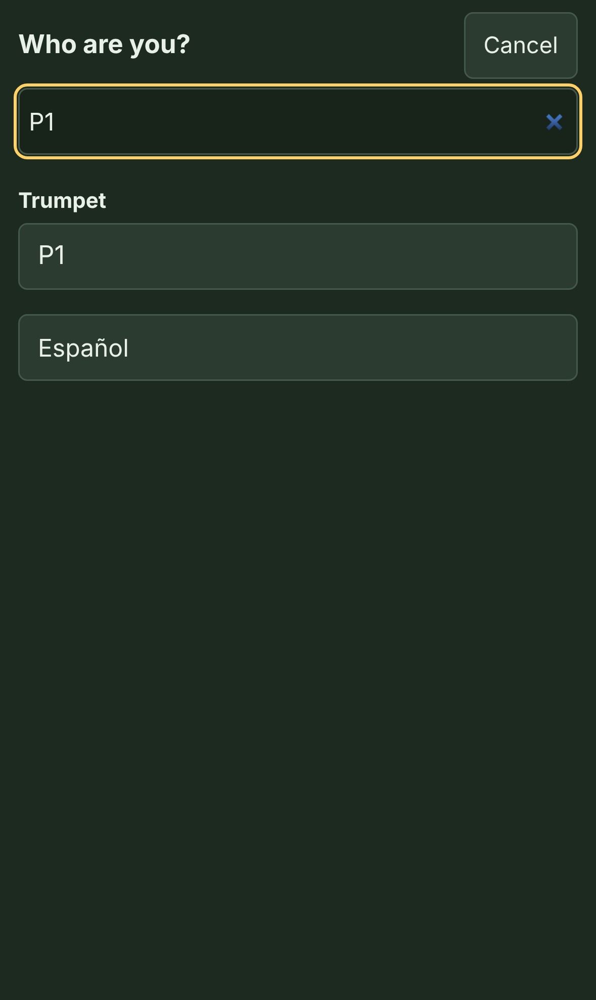
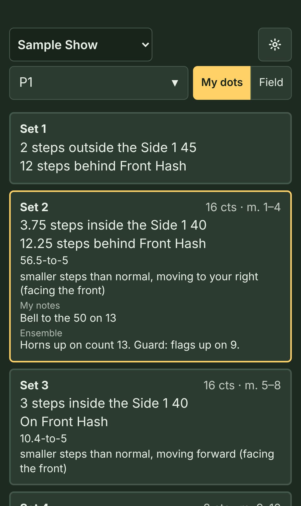
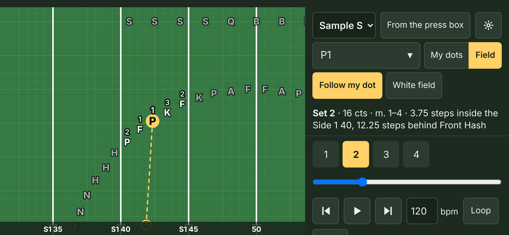

# FreeFORM para los integrantes

Tu director escribe el drill en FreeFORM y te manda un enlace. Esta página explica cómo usarlo en tu teléfono. Se lee en unos dos minutos.

## 1. Abre el enlace

Toca el enlace que te mandó tu director, o escanea el código QR con la cámara. El show se abre en el navegador de tu teléfono. No hay que instalar ninguna app ni crear una cuenta. Después de eso, el show queda guardado en tu teléfono, así que funciona en el ensayo sin señal.

Si el enlace se abre dentro de otra app (Instagram, Snapchat o una app del equipo), usa el menú de esa app para abrirlo en Safari o Chrome. Esos navegadores internos no siempre pueden guardar el show.

## 2. Elige quién eres

Toca el cuadro de arriba y búscate. Puedes buscar por tu nombre o por tu punto, como **G6**. El teléfono recuerda quién eres.

## 3. Lee tus puntos

Sostén el teléfono vertical. **Mis puntos** muestra una tarjeta para cada set, como una hoja de puntos impresa. Cada tarjeta tiene:

- el set, sus tiempos y sus compases
- tu lugar: primero de lado a lado, después de adelante hacia atrás
- cómo llegar: tu tamaño de paso y hacia dónde vas, como si miraras al frente
- tus notas y las notas del conjunto

El set en el que estás tiene un borde dorado. Toca una tarjeta para ir a ese set.

**"No es en línea recta (mira el movimiento)"** quiere decir que tu camino se curva o gira: un follow-the-leader, un giro o un camino que dibujó tu director. No camines derecho al nuevo lugar. Toca **▶ Ver el movimiento** debajo de esa tarjeta para ver el camino.

**"Mantener (mismo lugar que en el set 3)"** quiere decir que no te desplazas. Tus notas dicen qué hacer ahí, como marcar el paso o un visual.

## 4. Míralo en el campo

Pon el teléfono de lado, o toca **Campo**, para ver toda la banda.

- **Reproducir** corre el drill. Toca el número de un set para ir a él.
- **Seguir mi punto** te mantiene en el centro de la pantalla.
- **Desde el palco** gira el campo a **Mirando al frente**, como lo ves en el campo.
- **Repetir** repite unos sets, para practicar.
- **Clic** hace un clic en cada tiempo. Si tu director agregó la música, **♪ Música** la toca en su lugar.

## 5. Revisa tu revisión

Una línea en el teléfono (arriba de **Mis puntos**, y debajo del campo) te dice cómo está tu copia del show:

- **Listo sin internet** quiere decir que el show está guardado en este teléfono y funciona sin señal.
- **Revisión 6** es la versión que tienes. Cuando tu director diga "todos deben tener la revisión 7", revisa este número.
- Si tu director mantiene el show actualizado en línea, el teléfono busca una versión nueva cada vez que lo abres. **Buscar actualizaciones** vuelve a buscar ahora mismo. Si no tienes internet, la línea lo dice y usa la copia que ya tienes.

¿Sigues con una revisión vieja después de buscar? Pídele el enlace nuevo a tu director.

## Si algo no funciona

- **"No está guardado en este teléfono":** probablemente estás en una pestaña privada. Abre el enlace en una pestaña normal.
- **No encuentras tu nombre:** busca tu punto (como G6), o pregúntale a tu director.
- **Quieres un ícono en la pantalla de inicio:** en Safari, toca el botón Compartir y luego **Agregar a inicio**. En Chrome, toca el menú y luego **Agregar a la pantalla principal**. Abre el ícono y luego abre tu show ahí con **Escanear código QR** o pegando el enlace. (En un iPhone, el ícono tiene su propia lista de shows, aparte de la de Safari.)
- **Inglés:** FreeFORM sigue el idioma de tu teléfono. El botón **English** al final de **Mis puntos** lo cambia (y **Español** lo regresa).
