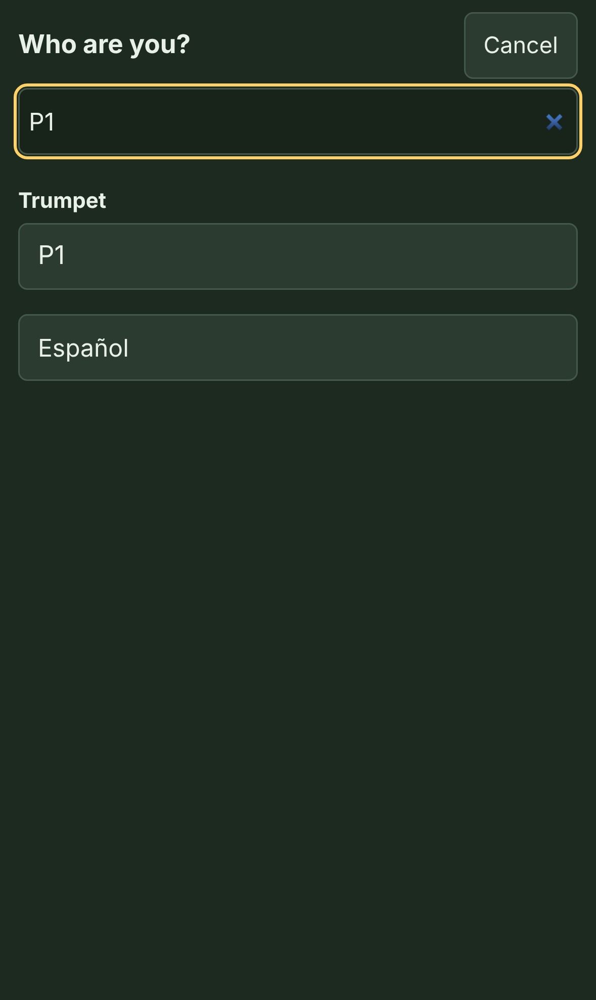
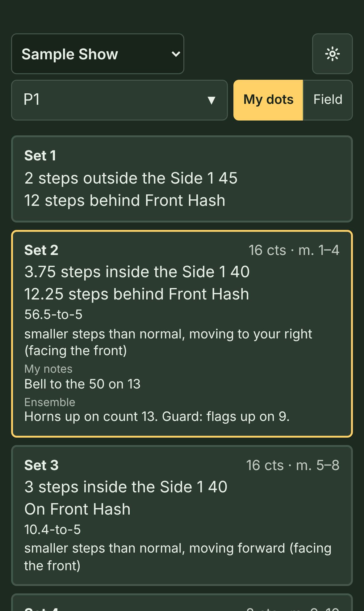
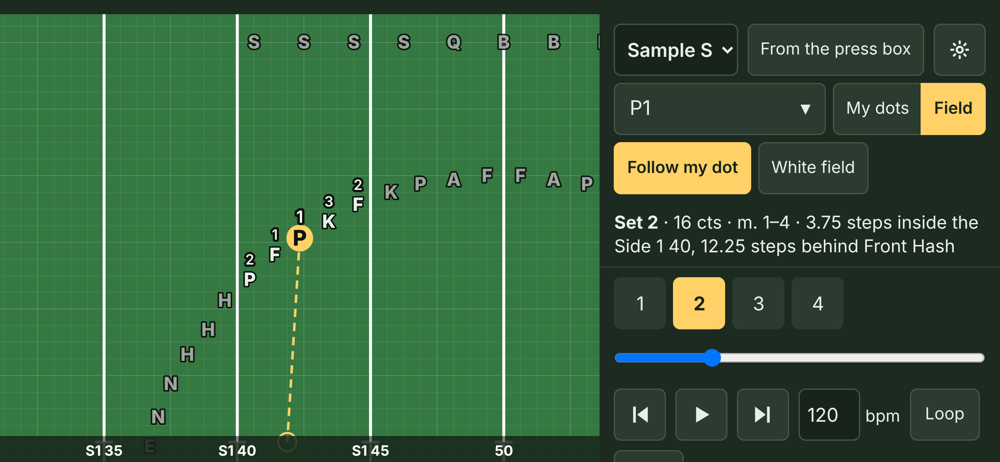

# FreeFORM Drill for performers

Your director writes the drill in FreeFORM Drill and sends you a link. This page shows you how to use it on your phone. It takes about two minutes to read. (The director's guide is [here](HOW-TO.md).)

## 1. Open the link

Tap the link your director sent, or scan the QR code with your camera. The show opens in your phone's web browser. There's no app to install and no account. The show is saved on your phone after that, so it works at rehearsal with no signal.

If the link opens inside another app (Instagram, Snapchat, or a team app), use that app's menu to open it in Safari or Chrome instead. Those built-in browsers can't always save the show.

## 2. Pick who you are

Tap the box at the top and find yourself. You can search by your name or your dot, like **G6**. The phone remembers who you are.

## 3. Read your dots

Hold the phone upright. **My dots** shows a card for every set, like a printed dot sheet. Each card has:

- the set, its counts, and its measures
- your spot: side to side first, then front to back
- how to get there: your step size and which way you go, as if you're facing the front
- your own notes and the ensemble notes

The set you're on has a gold outline. Tap a card to go to that set.

**"Not a straight line (watch the move)"** means your route curves or turns: a follow-the-leader, a turn, or a path your director drew. Don't just walk straight to the new spot. Tap **▶ Watch the move** under that card to see the route.

**"Hold (same spot as set 3)"** means you don't travel. Your notes say what to do there, like mark time or a visual.

## 4. Watch it on the field

Turn the phone sideways, or tap **Field**, to see the whole band.

- **Play** runs the drill. Tap a set number to jump to it.
- **Follow my dot** keeps you in the middle of the screen.
- **From the press box** turns the field around to **Facing the front**, the way you see it on the field.
- **Loop** repeats a few sets, for practice.
- **Click** clicks on every count. If your director added the music, **♪ Music** plays with it instead.

## 5. Check your revision

A line on the phone (at the top of **My dots**, and under the field) tells you about your copy of the show:

- **Ready offline** means the show is saved on this phone and works with no signal.
- **Revision 6** is which version you have. When your director says "everyone should be on revision 7," check this number.
- If your director keeps the show updated online, the phone checks for a new version each time you open it. **Check for updates** checks again right now. If you're offline, the line says so and uses the copy you already have.

Still on an old revision after checking? Ask your director for the new link.

## If something's wrong

- **"Not saved on this phone":** you're probably in a private browsing tab. Open the link in a regular tab.
- **You can't find your name:** search for your dot (like G6) instead, or ask your director.
- **You want an icon on your home screen:** in Safari, tap the Share button, then **Add to Home Screen**. In Chrome, tap the menu, then **Add to Home screen**. Open the icon, then open your show inside it with **Scan QR code** or by pasting the link. (On an iPhone, the home-screen icon keeps its own list of shows, separate from Safari's.)
- **Spanish:** FreeFORM follows your phone's language. The **Español** button at the bottom of **My dots** switches it (and **English** switches back).
